# CondPulse
## PRD, arquitetura e plano de implantação

**Versão 1.0 • 27 de outubro de 2026**

**Produto independente para moradores, portaria e gestão de condomínios.**

Documento de referência para implementação com agentes de IA, revisão técnica e homologação em campo. Inclui escopo comercial, jornadas, arquitetura, dados, contratos, segurança, identidade visual e sequência de execução.

**Estado desta entrega:** especificação e ativos de projeto. Não é um sistema implantado, não comprova capacidade de produção e não constitui homologação de equipamentos. Os exemplos usam dados fictícios. O prazo de 15–20 dias é uma meta condicionada aos gates deste documento, e não uma promessa de conclusão automática.

# 1. Resumo executivo e decisões fechadas

O CondPulse organiza as tarefas residenciais mais frequentes: reservar espaços, convidar visitantes, acompanhar acessos autorizados, receber encomendas, consultar avisos e falar com a portaria. A gestão configura as regras e trata exceções; a portaria trabalha em uma fila operacional, não em um ERP. O produto não replica os painéis internos, o financeiro ou a operação de engenharia do app-advanced.

O nome canônico é **CondPulse**, com C e P maiúsculos. A designação anterior “Advanced Morador” é substituída neste projeto. “ContPulse” não é a grafia da marca. A Advanced pode ser o canal de implantação e relacionamento, mas o produto terá repositório, ambientes, dados, identidade e operação próprios.

| Decisão | Especificação adotada |
| --- | --- |
| Backend | Java 25 LTS + Spring Boot; baseline de compatibilidade 4.1.2, conforme documentação consultada. Fixar patch e dependências na abertura do repositório. [R01] |
| Web | React + TypeScript estrito + Vite; React Router; TanStack Query; design system próprio. Vite é build, não arquitetura. |
| Aplicativo | React Native + Expo, com build de desenvolvimento próprio, não apenas Expo Go. [R13] |
| Organização | Monólito modular; API/BFF e worker separados como processos, no mesmo repositório e release. |
| Dados | PostgreSQL do projeto Supabase exclusivo do CondPulse; schema de negócio privado; migrações Flyway. |
| Identidade | Supabase Auth; MFA para operadores privilegiados; autorização de negócio no backend. |
| Arquivos | Supabase Storage privado; acesso autorizado pela API; foto biométrica transitória, preferencialmente enviada ao parceiro. |
| Hospedagem | Coolify para web, API e worker em recursos dedicados. Supabase gerenciado como escolha inicial para reduzir operação de banco/Auth. |
| Acesso físico | Um parceiro e uma combinação de equipamentos por primeira homologação; API de fabricante diretamente apenas em etapa posterior. |
| Operação assíncrona | Outbox e inbox no Postgres; entregas repetíveis e consumidores idempotentes; sem Kafka ou microserviços no lançamento. |
| Uso de IA | IA escreve e revisa código; não decide quem pode entrar, não compara rostos e não substitui teste de equipamento. |

A documentação é uma base de implementação, não uma garantia de “zero erro”. A tradução do requisito de tranquilidade é objetiva: estados verdadeiros, poucos fornecedores, confirmação por equipamento, contingência operável, testes reproduzíveis, backup restaurável e suporte com responsabilidades claras.

# 2. Objetivo, públicos e resultado comercial

O primeiro público é o condomínio sem sistema, que hoje depende de papel, planilha e mensagens. O segundo já possui aplicativo, mas precisa de uma melhoria verificável para trocar. A substituição deve considerar as funções realmente usadas e as dependências de ERP, portaria remota e hardware; não existe promessa de equivalência universal com qualquer concorrente.

A proposta comercial inicial mantém exatamente dois pacotes. Os preços foram definidos como hipóteses de validação, não como margem líquida garantida. [B02]

| Função | Essencial — R$ 249/mês | Completo — R$ 499/mês |
| --- | --- | --- |
| Cadastro e segurança | Vínculo verificado, privacidade e recuperação de acesso | Mesma segurança; nunca uma proteção inferior no plano de entrada |
| Reservas | Regras, disponibilidade, aprovação, cancelamento | Também fila de espera, convidados do evento e regras adicionais |
| Visitantes | Autorizações com validade e operação pela portaria | Também convite por link, recorrência e janelas programadas |
| Encomendas | Recebimento, aviso, guarda e retirada identificada | Também código de retirada e delegação específica |
| Comunicação | Avisos, documentos e pedidos acompanháveis | Também segmentação e fluxos de mudança/entrega de móveis |
| Operação | Painel de portaria e gestão local | Também jornadas conectadas e migração delimitada |
| Facial integrado | Não pressuposto | Recurso habilitável somente no escopo homologado e após apuração do custo do parceiro |

Não cobrar mais apenas porque o condomínio já tinha aplicativo. O preço maior precisa corresponder a funcionalidades e serviço recorrente superiores. Um condomínio sem sistema pode contratar o Completo; um que já tinha aplicativo pode escolher o Essencial.

Hardware, instalação, manutenção física, centrais humanas de portaria, SMS, taxas de parceiros e serviços extraordinários não estão automaticamente incluídos. Não haverá um terceiro plano de software; quando necessário, uma linha contratual identifica o serviço técnico ou a licença de acesso. Se isso ultrapassar o orçamento do cliente, a oferta precisa ser revista antes da venda.

A cobrança não pode bloquear automaticamente a entrada física de moradores. Inadimplência comercial exige tratamento contratual e operacional separado. Encerramento do serviço deve preservar a transição dos dados e o acesso físico existente.

**Indicadores de produto propostos:** ativação de 70% das unidades no primeiro mês do piloto, 90% de conclusão sem ajuda nas jornadas simples testadas, 100% dos turnos treinados, nenhuma dupla reserva confirmada e nenhuma exposição entre condomínios. Essas são metas de teste, não resultados já observados.

# 3. Benchmark e critérios de substituição

A pesquisa comparativa anterior documentou 11 soluções e foi incluída integralmente como referência histórica do levantamento de 26/10/2026. Ela não é um teste autenticado dos produtos. Esta especificação usa os aprendizados funcionais e atualiza os pontos de acesso físico com fontes oficiais adicionais. Não copia código, telas proprietárias ou identidade visual de concorrentes. [B01]

| Referência | Aprendizado aplicável ao CondPulse | Limite da comparação |
| --- | --- | --- |
| TownSq | Reservas e operação residencial devem se conectar à portaria. A Portaria Digital anunciada em 2026 inclui integração física. [R18] | Avaliar módulo contratado e equipamento; a marca não comprova escopo idêntico em todos os clientes. |
| MyCond | Encomendas podem ter captura assistida e conferência humana. [R19] | OCR/IA não entra como dependência do recebimento no lançamento. |
| Nextin | Uma controladora intermediária permite integrar cadastros e equipamentos; há documentação de integração Bravas. [R20] | Não significa que a API da Bravas esteja licenciada ou disponível para o CondPulse. |
| Condomob | Recursos sociais e acesso físico exigem distinguir operação, integração e confirmação de sincronização. [B01] | Não tratar todos os recursos do grupo Superlógica como incluídos em um único produto. |
| Condfy | Acesso temporário, credenciais e automações vinculadas ao uso dos espaços são referência de integração. [R21] | Não prometer compatibilidade física a partir de nomes comerciais genéricos. |
| Group / COM21 / Group COM | Aplicativo residencial e plataforma de acesso têm responsabilidades e contratos distintos. [R22] | COM21 é referência de geração anterior; identificar o produto efetivamente instalado. |
| uCondo | Pré-liberações, recorrência e registros pela portaria são úteis sem facial. A central consultada informa ausência de reconhecimento facial naquele escopo. [R23] | Revalidar disponibilidade antes de proposta comercial. |
| Acolweb | Reservas, comunicação e gestão são referências funcionais da pesquisa. [B01] | Funções financeiras ficam fora do núcleo do CondPulse. |
| Condofy | Separar valor do software de serviço prestado por uma administradora. [B01] | Não presumir que cancelar o app elimina o custo da administração. |
| NokNox | Referência histórica de experiência residencial e transição de usuários. [B01] | A pesquisa anterior registra descontinuação; não usar como concorrente operacional validado hoje. |

A ficha de substituição de cada condomínio deve registrar: recursos utilizados, custo realmente cancelável, ERP de origem, modalidade de portaria, equipamentos/modelos/firmwares, forma de exportação, reservas futuras, encomendas pendentes e autorizações vigentes. Cada item recebe um estado: equivalente, melhorado, preservado em outro sistema ou não atendido. A troca somente é autorizada quando os processos críticos tiverem uma solução explícita e aceita.

# 4. Escopo do lançamento e limites

**P0 — base vendável:** identidade e vínculos; unidades; reservas com aprovação; autorização de visitantes; chegada sem convite; encomendas; avisos; documentos; pedidos simples; portaria; administração local; trilha de auditoria; notificações; importação CSV controlada; backup/restauração; suporte e métricas.

**P1 — Completo, sujeito a aceite antes da venda:** convites compartilháveis, convidados ligados à reserva, prestadores recorrentes, delegação de retirada, fila de espera, solicitações de mudança e primeira integração facial homologada. P1 não significa opcional para um contrato que já prometa esses recursos.

**P2 — posterior:** pagamentos de reservas, ERP de administradora, OCR de encomendas, assistente de regulamento, câmeras ao vivo, leitura de placas, tags veiculares, automação de elevadores, marketplace, assembleia formal e atendimento omnichannel. O modelo de integração deixa espaço para evolução, sem antecipar complexidade não utilizada.

**Fora do produto inicial:** folha, contabilidade condominial, cobrança da cota, geração de boletos, perícia de documentos, vigilância por IA, reconhecimento facial desenvolvido pela CondPulse e operação humana 24 horas de portaria remota.

O lançamento de 20 dias deve se limitar a um perfil controlado de condomínio com portaria presencial. Um condomínio que exige facial equivalente ao fornecedor atual não pode ser considerado substituído integralmente enquanto a homologação não terminar. PWA pode permitir acesso ao sistema antes da aprovação das lojas, mas não equivale ao aplicativo nativo em todas as capacidades, especialmente notificações.

# 5. Organograma, governança e responsabilidades

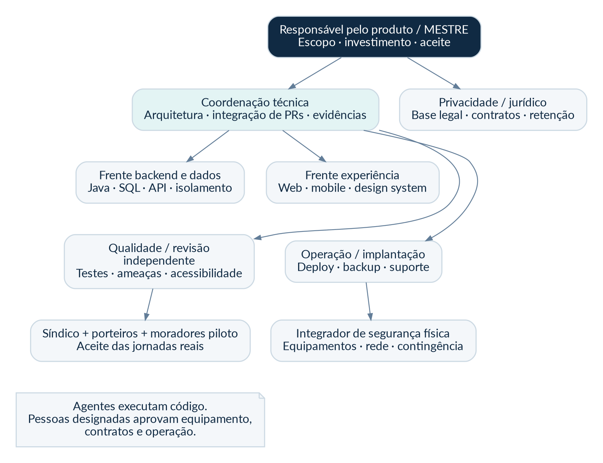

| Papel | Responsabilidade de entrega | Aprovação exigida |
| --- | --- | --- |
| Responsável pelo produto | Escopo, preço, prioridades e experiência | Aceite de negócio e decisão de comercializar |
| Coordenação técnica | Contratos, arquitetura, revisão de PR e consistência dos módulos | Merge e liberação técnica |
| Agentes de backend/dados | Implementação Java/SQL com testes e migrações | Revisão independente do autor |
| Agentes web/mobile | Jornadas, estados e componentes | Teste em dispositivo e comparação com design |
| Qualidade e segurança | Casos negativos, acesso cruzado, concorrência, acessibilidade | Relatório com evidências e bloqueios |
| Operação | Ambientes, segredos, observabilidade, backup e recuperação | Ensaio de restauração e runbooks |
| Integrador físico | Inventário, configuração, rede e contingência | Termo de homologação por modelo/firmware |
| Responsável por privacidade | Base legal, avisos, contratos e retenção | Liberação de tratamento biométrico |
| Condomínio piloto | Validação de regras e operação por turno | Aceite das jornadas e contingência |

Uma mesma pessoa pode acumular papéis, mas a responsabilidade deve estar explícita. Implementação 100% por IA não elimina a necessidade de alguém aprovar contratos, riscos, acesso ao ambiente e funcionamento físico. A revisão de código por outra IA é um apoio; não é certificação de segurança.

# 6. Identidade visual e princípios de experiência

A marca combina um C aberto com barras que representam edifícios e ritmo de comunidade. O arquivo original gerado na conversa permanece no pacote. A versão SVG é uma reconstrução técnica editável desse conceito, com letras convertidas em curvas e sem distribuição de arquivos de fonte. O registro de marca e a disponibilidade de domínio não foram pesquisados nem contratados.

| Token | Valor | Aplicação |
| --- | --- | --- |
| Navy | #102A43 | Texto principal, navegação e marca |
| Teal | #007F86 | Ações primárias e seleção |
| Fundo | #F4F7FA | Área de trabalho |
| Superfície | #FFFFFF | Cartões e formulários |
| Texto secundário | #52667A | Informação auxiliar legível |
| Sucesso | #166534 | Conclusão confirmada, nunca apenas envio |
| Atenção | #A15C00 | Pendência, espera e operação parcial |
| Erro | #B42318 | Falha com ação de recuperação |

Tipografia: Lato com fallback do sistema; corpo de 16 px, auxiliares preferencialmente 14 px ou maiores, espaçamento de 1,5. A escala de espaços é 4/8/12/16/24/32/48 px. Cartões têm raio 16 px e controles 10 px. Alvos de toque têm pelo menos 48 px como padrão do produto. Não depender apenas de cor; todos os estados usam texto e ícone. O objetivo de acessibilidade é WCAG 2.2 AA, a verificar com automação e testes humanos. [R14]

Não encher o aplicativo de gráficos ou menus de administração. A home destaca próxima ação: pessoa aguardando resposta, encomenda a retirar ou reserva próxima. A portaria prioriza trabalho pendente. A gestão prioriza exceções e saúde das integrações. Dinheiro e situações de segurança não devem usar animações que sugiram confirmação antecipada.

# 7. Mockups do morador, portaria e mapa de telas

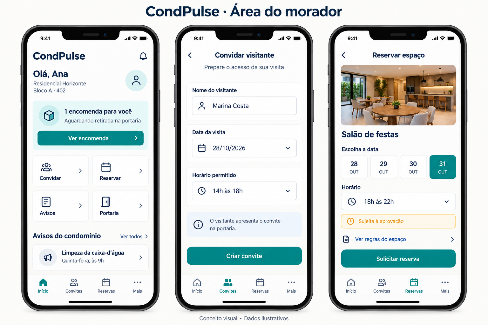

As três telas seguintes ampliam o mesmo conceito visual para leitura e discussão de usabilidade. São recortes do mockup apresentado, sem comportamento executável.

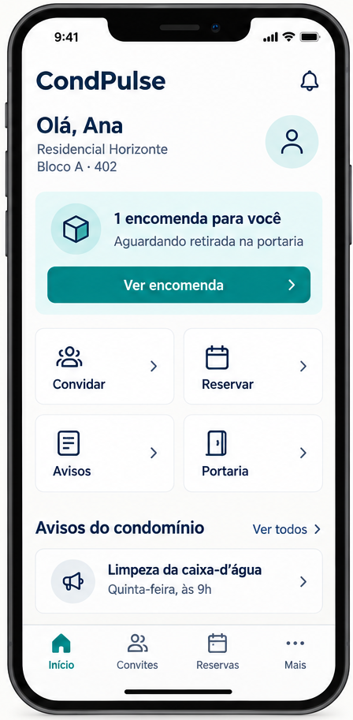

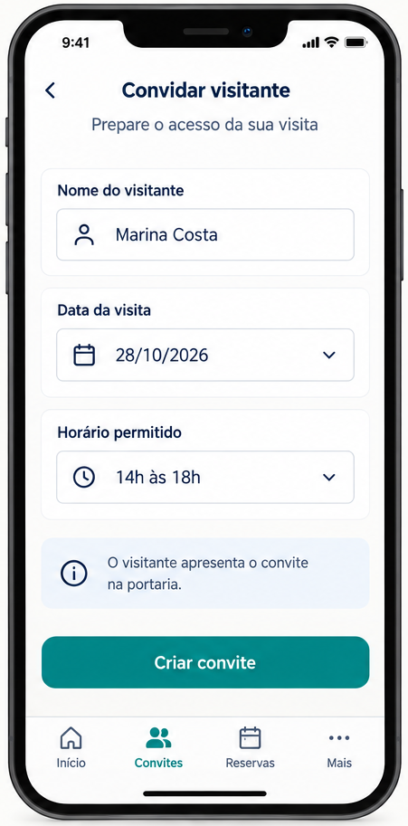

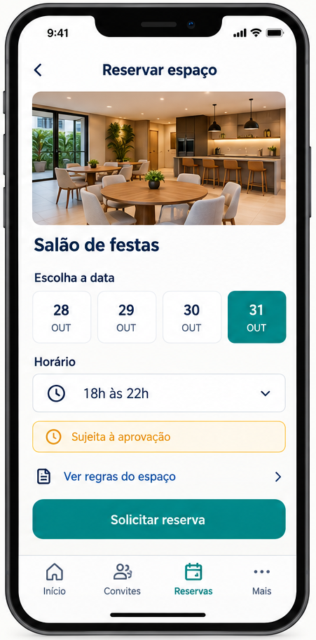

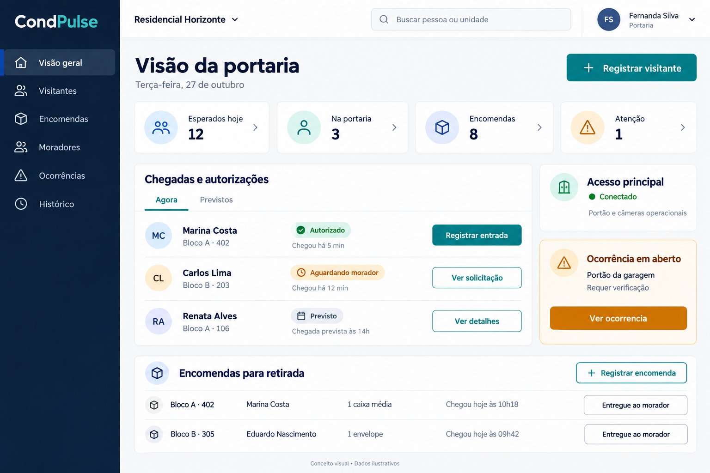

Os mockups são referências visuais, não telas implementadas. O texto “Portão e câmeras operacionais” da imagem não será usado como evidência real: na implementação, cada equipamento mostrará a última comunicação e o sinal efetivamente disponível. A presença de uma pessoa “prevista” no quadro da imagem deve ser movida à aba **Previstos**, separada de quem efetivamente chegou.

A navegação final do morador terá Início, Acessos, Reservas e Mais. “Acessos” reúne convites, pessoas esperadas e histórico da própria unidade. A mudança de “Convites”, presente no mockup, é intencional para acomodar acompanhamento de entradas e saídas. A home mantém quatro atalhos: Convidar, Reservar, Encomendas e Portaria.

| Tela | Conteúdo e ação principal | Estados obrigatórios |
| --- | --- | --- |
| MOR-01 Início | Condomínio/unidade em uso; pendências; próxima reserva | Sem vínculo, carregando, sem pendências, dados desatualizados |
| MOR-02 Acessos | Convites e histórico autorizado da unidade | Previsto, aguardando, entrada registrada, saída registrada, sem saída identificada |
| MOR-03 Convidar | Pessoa, período, finalidade e compartilhamento | Rascunho local, criado, expirado, revogado |
| MOR-04 Reservar | Área, regras, taxa, disponibilidade e pedido | Conflito, pendente, confirmada, rejeitada, cancelada |
| MOR-05 Encomendas | Local de guarda e retirada/delegação | Recebida, aviso em processamento, retirada |
| MOR-06 Meu acesso | Cadastro facial e equipamentos aplicáveis | Pendente de análise, sincronizando, parcial, ativo, revogando |
| MOR-07 Pedidos | Abertura e acompanhamento | Enviado, em análise, em execução, aguardando morador, concluído |
| POR-01 Operação | Agora/Previstos, busca e ações por prioridade | Conectado, indisponível, retomando, conflito de ação |
| POR-02 Recebimento | Unidade, quantidade e local | Unidade não encontrada, confirmação, duplicidade suspeita |
| POR-03 Retirada | Encomenda, pessoa e evidência | Código inválido, expirado, usado, entrega confirmada |
| GES-01 Visão local | Pendências, aprovação e saúde do acesso | Sem dados, indisponível, alertas ativos |
| GES-02 Configuração | Áreas, horários, moradores e responsáveis | Validação, alteração em vigor, regra versionada |
| OPS-01 Administração SaaS | Contratos, uso e suporte temporário | Sem acesso ao conteúdo por padrão; acesso justificado |

Responsividade: 360–767 px em uma coluna; tablet com duas regiões conforme função; portaria desktop a partir de 1280 px. Tabelas extensas viram cartões no celular. Testar 200% de zoom, teclado, leitores de tela, nomes longos, campo de busca e turno de portaria com tela aberta por horas. Não depender de hover.

# 8. Perfis, vínculos e visibilidade

A unidade de isolamento é o condomínio, identificado por `tenant_id`. Uma conta pode ter vínculos em vários condomínios ou unidades. Estar autenticado não concede acesso a um condomínio. Cada requisição exige vínculo ativo, papel, permissão e contexto compatíveis.

| Perfil | Pode fazer | Não pode fazer |
| --- | --- | --- |
| Morador autorizado | Reservar, convidar e consultar o que pertence à sua unidade e ao seu escopo | Ver visitas ou encomendas de outras unidades; conceder papel administrativo |
| Familiar/dependente autorizado | Ações concedidas explicitamente pelo responsável e pela política local | Autorizar terceiros por padrão sem permissão; consultar dados privados de outro adulto |
| Proprietário não residente | Consultas que a política do condomínio autorizar | Monitorar automaticamente a rotina pessoal do locatário |
| Porteiro | Tratar chegadas, encomendas e eventos do condomínio em seu turno | Exportar biometria, consultar outros condomínios, alterar regras comerciais |
| Gestor local | Aprovar vínculos e reservas; configurar regras; tratar exceções | Acessar outros condomínios sem vínculo |
| Suporte CondPulse | Diagnóstico técnico com metadados | Consultar conteúdo pessoal sem concessão temporária auditada |
| Administrador SaaS | Contratos, capacidade e configuração da plataforma | Impersonação silenciosa ou acesso universal sem auditoria |

O histórico de acessos não é uma ferramenta de vigilância doméstica. Por padrão, o morador visualiza as visitas da unidade que está autorizado a acompanhar e seus próprios eventos. A exposição de movimentos de outros adultos requer política específica e aprovação de privacidade. Menores e situações de proteção exigem regra própria; o facial de menores fica desabilitado no lançamento até análise específica.

O desligamento de um vínculo bloqueia novas operações imediatamente no backend, invalida sessões pertinentes e gera revogação das credenciais associadas. A exclusão no banco não é prova de exclusão no equipamento. A interface deve mostrar revogações físicas ainda pendentes.

# 9. Cadastro, login e recuperação de acesso

**Entrada de condomínio:** cadastro do tenant, blocos, unidades, áreas e regras; responsável designado; importação em prévia; aprovação de registros válidos; treinamento. Não criar vínculos apenas porque alguém conhece um número de apartamento.

**Entrada do morador:** convite individual de validade curta; confirmação do canal; criação ou recuperação de conta; solicitação de vínculo; validação por responsável; acesso concedido. A mesma pessoa não precisa de uma nova conta para outro condomínio, mas precisa de um novo vínculo. A importação não envia convites sem revisão do destinatário e confirmação do operador.

O login inicial usa Supabase Auth. Moradores podem utilizar e-mail/senha ou OTP por e-mail conforme a configuração escolhida no D1. O canal telefônico só é habilitado depois de contratar e validar SMS. Não implementar senha própria em Java e não usar WhatsApp como atalho de autenticação. O cadastro deve oferecer assistência da gestão para pessoas sem familiaridade digital.

Web: BFF Spring recebe o fluxo de login e mantém tokens do provedor criptografados no servidor; entrega cookie de sessão opaco, Secure, HttpOnly, SameSite=Lax, prefixo `__Host-`, e proteção CSRF nas alterações. O navegador não persiste refresh token em localStorage. Mobile: fluxo nativo do provedor, PKCE quando aplicável e refresh token em armazenamento seguro do dispositivo, sem registro em logs.

MFA TOTP é exigido para gestão, suporte e administração. A portaria usa conta individual por operador e dispositivo autorizado, nunca uma senha compartilhada por turno; operações privilegiadas exigem autenticação reforçada. Supabase fornece mecanismos de MFA e nível de garantia; a exigência deve ser aplicada no backend, não apenas ocultando botão. [R04]

Recuperação deve produzir mensagem neutra para evitar enumeração de contas, limitar tentativas, expirar links e encerrar sessões conforme a política. “Senha alterada” só aparece após confirmação real. Mudança de e-mail, unidade ou responsável tem auditoria e nova validação. Cancelar o vínculo não apaga automaticamente registros de negócio com retenção legítima.

# 10. Reservas: regras, concorrência e cancelamento

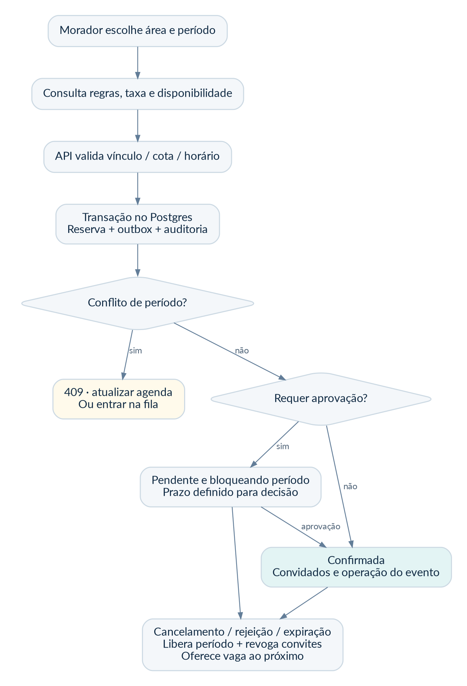

Cada área possui horário de funcionamento, antecedência mínima, janela máxima, duração, capacidade, intervalo de limpeza, limite por unidade, taxa informativa e necessidade de aprovação. As regras são versionadas. Uma reserva guarda o retrato da regra aceita e da taxa vigente; mudança posterior não altera silenciosamente uma reserva confirmada.

Fluxo: escolher área; consultar calendário; escolher início/fim; ver regras e taxa; confirmar pedido com chave de idempotência; API revalida tudo; banco tenta gravar o período; interface exibe o estado devolvido. Consultar a agenda não “segura” o horário. A reserva só existe depois do commit.

**Estados:** HELD é retenção temporária para oferta de fila; PENDING_APPROVAL bloqueia o período e exige decisão até o prazo; CONFIRMED é confirmação; REJECTED, CANCELLED e EXPIRED não bloqueiam. Um bloqueio de manutenção é registro de tipo BLOCK no mesmo conjunto de exclusão, não uma tabela independente que permita colisões.

A restrição de exclusão no PostgreSQL usa tenant, área e intervalo de ocupação. Intervalos são `[início, fim)`, com buffer de limpeza incluído. Ela impede sobreposição mesmo em requisições concorrentes; a API converte o conflito em HTTP 409 com agenda atualizada. A documentação do PostgreSQL apresenta esse tipo de proteção para reservas. [R08]

O limite de reservas por unidade é conferido sob bloqueio transacional da unidade ou uma trava equivalente, pois a restrição de horário sozinha não protege cotas entre áreas. Horários são armazenados como `timestamptz`; exibição e recorrência usam o fuso IANA do condomínio, inicialmente America/Sao_Paulo. Não codificar “UTC menos três” em regras de calendário.

**Aprovação:** o gestor confirma ou rejeita com motivo. Prazo recomendado inicial de 24 horas, nunca ultrapassando o início do evento; cada condomínio pode configurar a política. Aprovação tardia de pedido expirado exige nova tentativa e nova verificação de disponibilidade. A taxa fica “a encaminhar/encaminhada/confirmada pela administração”, nunca “paga” sem integração ou evidência autorizada.

**Fila de espera:** cancelamento ou expiração oferece a vaga ao próximo elegível; cria HELD por 15 minutos como configuração inicial. Apenas uma oferta ativa ocupa o slot. Oferta expirada avança a fila. O worker limpa holds expirados; a API também verifica expiração sob trava antes de avaliar o intervalo. Cotas, ordem e desistências são auditadas.

**Cancelamento:** confirma impacto, registra autor e motivo, libera o horário e gera revogação dos convites vinculados na mesma transação. As credenciais do equipamento podem ficar pendentes de revogação; isso precisa aparecer na portaria. Não criar autorização ilimitada para um convidado de evento cancelado.

# 11. Visitantes, pedestres e acompanhamento de acessos

Convite é uma autorização temporal, não prova de identidade nem prova de entrada. A portaria mantém a conferência prevista no procedimento do condomínio. O sistema não deve transformar a posse de um link público em permissão irrestrita.

**Visita prevista:** nome mínimo, unidade, finalidade, data e período. No Completo, um link de alta entropia permite visualizar o convite e, quando autorizado, concluir dados necessários. O token é guardado como hash, pode ser revogado, expira e não contém nome, CPF ou apartamento na URL. Uso único significa uma utilização do convite, não “uma tentativa de leitura” que o torne inútil ao primeiro erro.

**Chegada sem convite:** operador registra a pessoa e a unidade; cria solicitação com prazo de 5 minutos como padrão configurável; notifica os membros aptos a responder; primeira decisão válida muda o estado atomicamente. Nova decisão recebe 409; vencimento invalida resposta atrasada. Sem resposta não existe autorização automática: seguir o interfone e o procedimento presencial aprovado, registrando a origem da confirmação.

**Prestador recorrente:** regra limitada por dias da semana, horário local e período final; gerar janelas explícitas com horizonte curto, recalculadas no fuso do condomínio. Revogar a regra invalida janelas futuras e credenciais derivadas. Não programar recorrência indefinida diretamente no equipamento sem política de expiração e reconciliação.

**Estados que o morador vê:** convidado, aguardando autorização, autorizado, entrada registrada, saída registrada ou sem registro de saída. Mostrar fonte: “registrado pela portaria” ou “passagem identificada pelo equipamento”. Comando de abertura, relé acionado e pessoa atravessando são eventos diferentes. Os equipamentos Control iD, por exemplo, distinguem classes de eventos no Monitor. [R10]

A saída só é identificada automaticamente quando a instalação fornece informação compatível. Uma botoeira sem identificação não permite concluir quem saiu. “Está no condomínio” deve ser evitado quando só existe entrada sem evidência de saída; usar “último registro: entrada às 14h32”. A função não substitui controle de evacuação ou sistema de segurança de vida.

O atraso do relógio do equipamento e o recebimento tardio são preservados com dois horários: ocorrência informada e recebimento no servidor. Eventos repetidos não geram notificações repetidas. Correção humana gera um evento de correção referenciando o anterior, sem apagar evidência.

# 12. Encomendas, comunicação e solicitações

**Receber encomenda:** buscar unidade; registrar quantidade, descrição curta e local; opcionalmente fotografar a embalagem sem necessidade de expor documento pessoal; confirmar; gravar recebimento e tarefa de aviso; retornar sucesso do registro mesmo que push ainda esteja pendente. Uma encomenda não pode desaparecer porque a notificação falhou.

**Entregar:** selecionar o registro; conferir pessoa e eventual delegação; validar código temporário; confirmar entrega em transação; registrar operador, recebedor e horário. Uma restrição única no registro de handoff e mudança condicional de estado impedem duas entregas para a mesma encomenda. Uma segunda tentativa retorna “já retirada”, com dados mínimos autorizados.

**Delegar:** morador habilita outra pessoa para uma encomenda específica, com validade; código numérico com limite de tentativas e armazenamento com HMAC/segredo do servidor; expira ao usar ou revogar. Não usar número de apartamento ou telefone como código. Portaria não entrega só porque alguém sabe o nome do morador.

**Avisos:** rascunho, publicação e arquivamento; destinatários definidos por condomínio/bloco/unidade; anexos privados; confirmação de leitura significa abertura autenticada, não recebimento de push. Não publicar dados de inadimplência ou documentos pessoais em mural. A segmentação é aplicada na API e nas notificações.

**Documentos:** nome legível, categoria, versão e data; upload com limite de tamanho, MIME verificado, análise e estado de quarentena; liberar somente após validação. Links temporários não substituem controle de acesso: a API verifica vínculo antes de emiti-los. Política inicial: fotos até 10 MB e PDFs até 20 MB, sujeita a teste e custo.

**Solicitações:** categorias simples, descrição, foto opcional, responsável e prazo comunicado. Estados: OPEN, TRIAGED, IN_PROGRESS, WAITING_RESIDENT, RESOLVED e CLOSED. Resolução descreve o resultado; fechamento preserva histórico. Comentários internos não aparecem ao morador. Mudança e entrega de móveis acrescentam janela, dados do prestador e comunicação à portaria; não autorizam obra estrutural por si sós.

A integração futura com Advanced deve ter uma origem oficial para o pedido, identificador externo e mapeamento de estados. Não criar duas filas sem reconciliação. O CondPulse continua operacional se esse conector opcional estiver indisponível. IA de texto/OCR pode ser adicionada posteriormente; nenhuma etapa essencial depende de resposta de modelo.

# 13. Arquitetura de contexto e responsabilidades

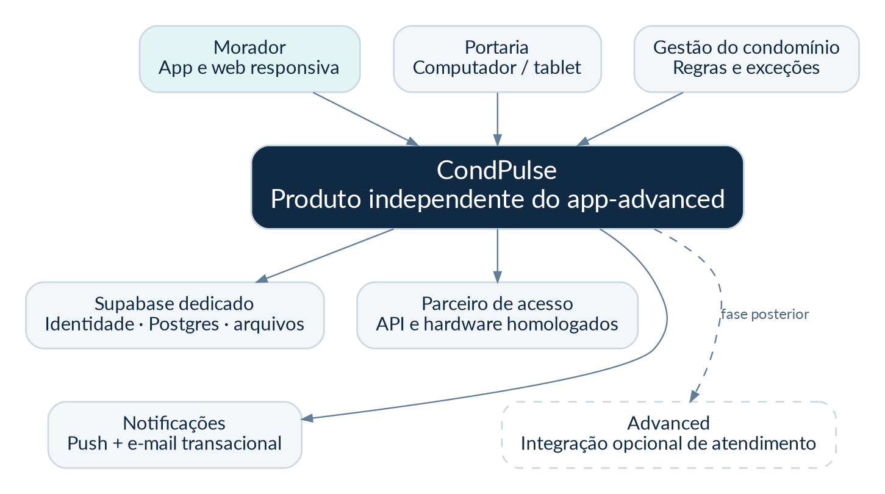

A fonte oficial dos processos residenciais é o banco do CondPulse. Supabase Auth é a fonte da identidade autenticada, não das permissões de condomínio. O parceiro de acesso confirma a aplicação física das credenciais e fornece eventos. O aplicativo nunca conversa diretamente com leitores na rede local e não contém credenciais do parceiro.

A fronteira com Advanced é uma API opcional, a ser especificada separadamente. Não compartilhar o mesmo banco, bucket, chave de autenticação ou tenant administrativo para acelerar implantação. Nenhuma alteração no app-advanced é necessária para iniciar este projeto. A existência de infraestrutura Advanced não comprova disponibilidade para hospedar o CondPulse.

O sistema é desenvolvido para múltiplos condomínios, mas não pressupõe capacidade infinita. A expansão ocorre por medição de concorrência, throughput, banco e suporte. Novos clientes que dependem de equipamentos ainda não homologados não entram na promessa de acesso automático.

# 14. Camadas, módulos e organização do repositório

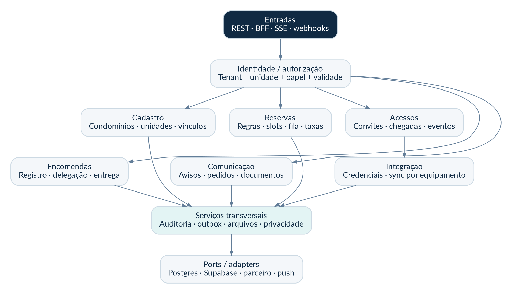

Backend: monólito modular orientado a funcionalidades. Dentro de cada módulo, separar `api`, `application`, `domain` e `infrastructure`. A camada de domínio não conhece HTTP, Supabase, SDK do parceiro ou formato de notificação. Um controller transforma e valida a requisição; um caso de uso coordena regras e transação; adaptadores acessam banco e serviços externos.

Evitar “arquitetura limpa” ornamental com dezenas de interfaces sem função. Portas são úteis para fornecedores substituíveis, relógio, armazenamento e persistência de invariantes. Módulos não escrevem diretamente em tabelas de outros módulos; usam serviço publicado ou evento definido. Uma alteração de regra de reserva pertence ao módulo Reservas, não ao componente React.

| Diretório | Responsabilidade |
| --- | --- |
| `apps/backend` | Maven multimódulo ou módulos por pacote; aplicação API/BFF e perfil worker |
| `apps/web` | Experiência responsiva de morador, portaria e gestão; rotas segregadas |
| `apps/mobile` | App React Native/Expo; navegação e recursos nativos |
| `packages/api-client` | Tipos e cliente TypeScript gerados do OpenAPI |
| `packages/design-tokens` | Cores, espaçamentos e contratos visuais compartilháveis |
| `contracts` | OpenAPI, esquemas de eventos e exemplos sintéticos |
| `db/migrations` | Migrações versionadas, nunca executadas pelo frontend |
| `infra` | Container, configuração e runbooks; sem segredos |
| `docs/adr` | Decisões de arquitetura e mudanças aprovadas |
| `tests` | Contratos, E2E, carga, isolamento e fixtures sintéticas |

API e worker podem usar a mesma imagem imutável com perfis de execução diferentes. O worker não expõe endpoints públicos. Nenhum job externo deve rodar dentro da transação de reserva. Estado de negócio e outbox são gravados juntos; processamento externo vem depois.

Persistência: Spring Data/JPA para CRUD com limites de agregado e consultas explícitas; SQL nativo/JDBC nos casos em que constraints, locks e filas precisam de controle. Configurar `ddl-auto=validate`, nunca `update` em ambiente compartilhado. Usar Flyway como único responsável por mudanças de schema. Testes de integração devem usar PostgreSQL real, não H2, para exercitar RLS, intervalos e exclusões.

# 15. Frontend, mobile e contratos de interface

O painel web é uma aplicação React com TypeScript estrito. Organizar código por jornadas, com módulos `identity`, `reservations`, `access`, `parcels`, `communications` e `management`. Componentes de apresentação não implementam autorização; consultam capacidades retornadas pela API e exibem a ação correta. Toda permissão é revalidada no servidor.

TanStack Query mantém o estado remoto; o identificador de condomínio e unidade faz parte de cada chave de cache. Trocar de contexto cancela requisições em andamento e remove conteúdo do contexto anterior. Não manter caches globais por `id` sem tenant. Logout limpa cache, armazenamento local e subscrição de eventos. Nunca compartilhar chave de cache de portaria e morador.

Ações sensíveis não usam confirmação otimista: entrada, saída, retirada, aprovação, cancelamento e cadastro facial aguardam retorno de negócio. O botão pode mostrar progresso e impedir cliques repetidos, mas isso não substitui idempotência no servidor. O usuário vê a diferença entre erro de rede e recusa de regra.

O app React Native usa Expo Router ou uma navegação única decidida no D1 e mantida pelo projeto. Builds de desenvolvimento próprios são necessários para testar permissões, notificações e módulos nativos. [R13] Código compartilhado com a web limita-se a contratos, tokens e lógica pura realmente compatível. Não forçar um componente de tabela desktop para dentro de uma tela nativa.

O visitante não precisa instalar o app. O portal de convite é web leve, com token expirável e sem qualquer listagem de condomínio. Rotas públicas não permitem enumeração de unidades. A foto facial, quando necessária, só é solicitada depois de explicar finalidade e alternativa de acesso.

**Estados de interface obrigatórios:** carregando; vazio com ação útil; permissão insuficiente; conexão indisponível; dado antigo; conflito concorrente; operação pendente; parcial; concluído; erro recuperável; erro que exige suporte. Mensagens não exibem SQL, stack trace ou nome interno de tabela.

# 16. Contratos de API e semântica de erros

O arquivo `api/openapi.yaml` define a superfície inicial e os esquemas centrais. A versão é `/v1`; mudanças incompatíveis exigem nova versão e plano de compatibilidade com aplicativos antigos. O contrato é do CondPulse, não uma afirmação sobre endpoints do parceiro facial.

| Convenção | Regra |
| --- | --- |
| Identificadores | UUID opaco; não usar número de unidade como chave pública |
| Contexto | `/v1/tenants/{tenantId}/...`; o backend verifica o vínculo antes de consultar |
| Unidade | Parâmetro ou atributo validado; não confiar em unidade enviada pelo cliente |
| Data e hora | ISO 8601 com offset/UTC; zona IANA para regras de calendário |
| Valores | Inteiro em centavos; moeda BRL explicitamente indicada |
| Paginação | Cursor opaco, limite padrão 30 e máximo 100; ordenação determinística |
| Alterações | `Idempotency-Key` nas operações críticas; `If-Match`/versão quando houver edição concorrente |
| Erros | `application/problem+json`, código estável e `traceId`, sem detalhes internos |
| Assíncrono | 202 com operação rastreável; não responder “ativo” antes do hardware |

Chave de idempotência: escopo por tenant, ator, método e rota. Guardar hash do corpo e resultado autorizado. Mesma chave e mesmo corpo retornam o resultado anterior; mesma chave e corpo diferente retornam 409. Reter inicialmente por 24 horas, mais que o período de retry do cliente. Para credenciais e eventos externos, usar chaves permanentes do domínio, não depender apenas dessa janela.

| Código | Situação e ação da interface |
| --- | --- |
| 400 | Formato inválido; orientar campo sem perder formulário |
| 401 | Sessão ausente/expirada; renovar uma vez ou reautenticar |
| 403 | Ação não permitida; não tentar outro tenant automaticamente |
| 404 | Recurso inexistente ou não visível conforme política anti-enumeração |
| 409 | Horário ocupado, versão antiga, decisão já tomada ou repetição incompatível |
| 422 | Regra de negócio não atendida, com explicação concreta |
| 429 | Limite atingido; respeitar `Retry-After` |
| 503 | Dependência necessária indisponível; preservar estado e informar próximo passo |

`traceId` acompanha logs técnicos sem dados biométricos. O backend não retorna o segredo do parceiro, hash de token, refresh token, foto de outro morador ou caminho interno de bucket.

# 17. Dados: entidades, relações e invariantes

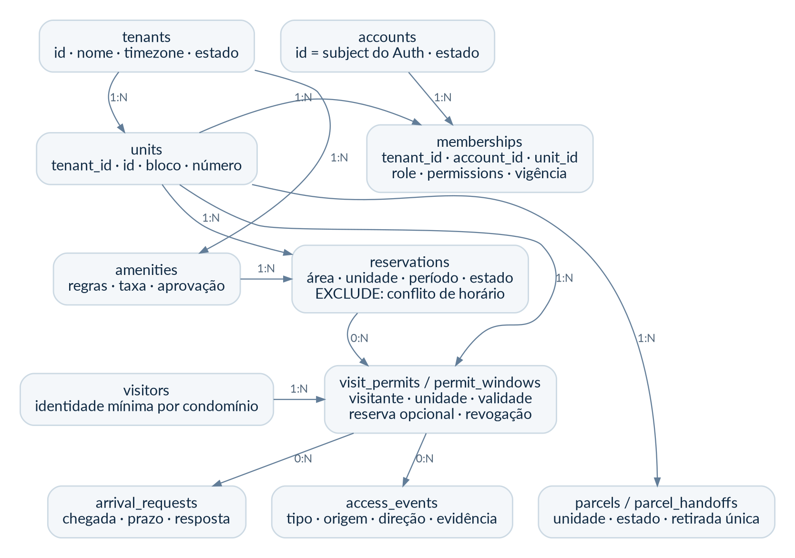

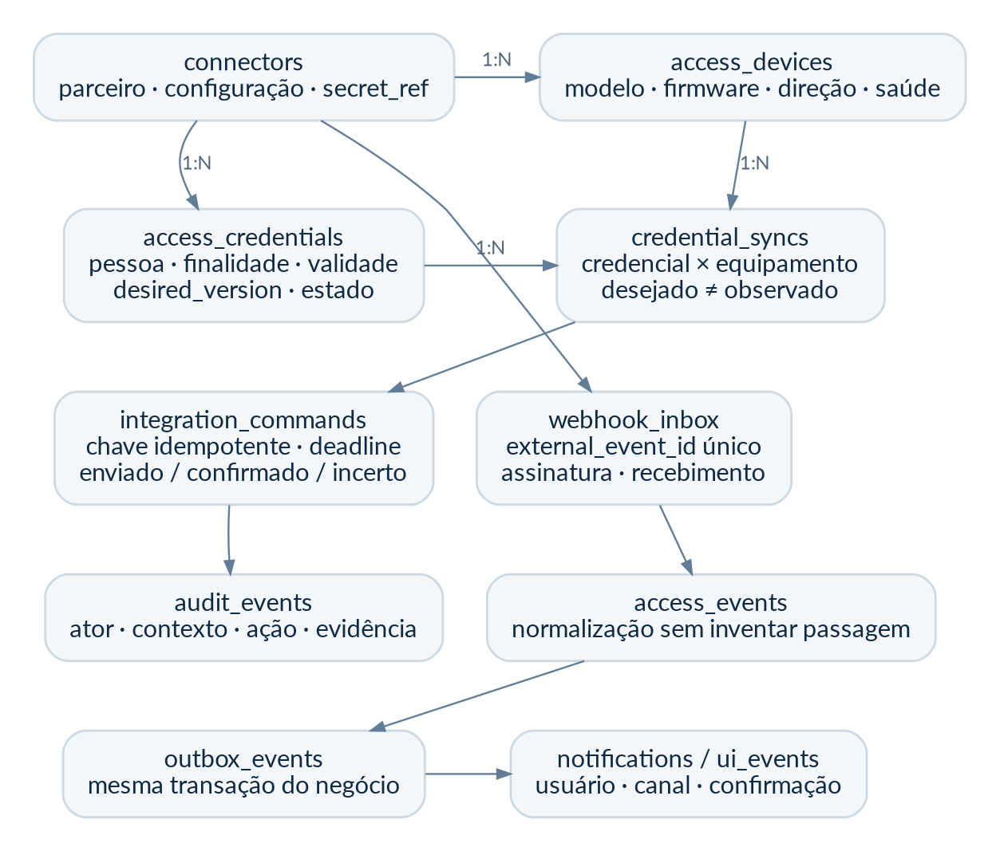

O schema `platform` guarda identidade técnica e catálogo de tenants. O schema `cp` guarda dados de negócio. Contas referenciam o subject do Supabase Auth por UUID, mas a migração não cria nem modifica o schema interno `auth`. Isso evita acoplamento a migrações do provedor; o serviço de identidade faz a reconciliação.

Toda tabela de negócio tem `tenant_id`. Chaves estrangeiras entre tabelas desse conjunto incluem `(tenant_id, id)`, impedindo uma relação cruzada acidental. Índices de consulta começam pelo contexto ou pelas colunas realmente usadas no filtro. `created_at`, `updated_at`, `version` e estados explícitos servem para rastrear alteração, não como substitutos de auditoria.

| Invariante | Proteção exigida |
| --- | --- |
| Duas reservas bloqueantes não se sobrepõem | Constraint EXCLUDE por tenant, área e período efetivo |
| Não relacionar unidade de outro condomínio | FKs compostas com tenant |
| Uma encomenda não é entregue duas vezes | UNIQUE por encomenda no handoff + transação de estado |
| Um webhook repetido não duplica acesso | UNIQUE por conector e ID externo, ou fingerprint estável validado |
| Um pedido de chegada não aceita duas decisões | UPDATE condicional por estado/versão + teste concorrente |
| Revogação mais nova não é revertida por resposta antiga | `desired_version` e confirmação por equipamento |
| Tenant nunca vem de campo arbitrário sem verificação | Contexto validado pela API + RLS em transação |
| Auditoria não muda com uma edição normal | Permissão de inserção; sem UPDATE/DELETE para papéis de aplicação |

O SQL entregue é uma migração inicial de referência para revisão e execução em ambiente descartável. Não representa validação contra o projeto Supabase de produção. A estrutura inclui campos essenciais e constraints; as regras de autorização por pessoa/unidade continuam no serviço e nos testes de integração. A implantação deve rodar as migrações e validar planos de consulta antes de abrir o piloto.

Retenção e apagamento são explícitos. Um pedido de exclusão de conta não apaga cegamente handoffs, eventos ou auditorias. Identificadores pessoais podem ser pseudonimizados quando a finalidade permitir, mantendo integridade operacional. A exclusão de foto biométrica exige confirmação dos objetos transitórios e dos destinos aplicáveis.

# 18. Autorização, RLS e isolamento entre condomínios

Supabase não será usado como acesso direto do cliente às tabelas de negócio. A API Java acessa o Postgres por uma role dedicada sem SUPERUSER e sem BYPASSRLS. O schema `cp` não é exposto na Data API. Se a Data API não for utilizada, desabilitá-la; manter Auth e Storage apenas com os caminhos necessários. As chaves secretas e service role nunca vão para o frontend. [R03]

Antes de qualquer consulta: validar assinatura, issuer, audience, expiração e subject; localizar conta ativa; resolver o vínculo em vigor; conferir papel/capacidade; validar tenant e unidade. Spring Security fornece suporte a JWT, mas configurar issuer não dispensa as demais verificações e a autorização local. [R02]

Na transação, executar `set_config('app.tenant_id', tenantValidado, true)` e `set_config('app.actor_id', actorValidado, true)`. O terceiro argumento localiza o contexto à transação, evitando vazamento por pool de conexões. O driver não deve enviar isso fora da mesma conexão/transação usada pela consulta. Tests com pool reutilizado são obrigatórios.

RLS faz a barreira de tenant com `ENABLE` e `FORCE ROW LEVEL SECURITY`. Ela não torna automaticamente um morador autorizado a ver todas as linhas da própria unidade. O escopo de pessoa, unidade, finalidade e papel é aplicado pelo domínio e revalidado antes de emitir documentos ou eventos. Não anunciar “RLS resolve tudo”. As documentações do Supabase alertam para o bypass por papéis privilegiados. [R05]

O worker processa um tenant por transação. Uma função/consulta limitada fornece a lista de tenants ativos, sem expor seus dados. Jobs carregam o contexto a partir de registro confiável, nunca de payload público não autenticado. O usuário de migração é diferente do usuário da API e só fica disponível no job de release.

Uma conta de suporte utiliza concessão temporária com justificativa, escopo, expiração e auditoria. Nenhum “superadmin” deve funcionar como acesso invisível a todo conteúdo. Exports e consultas a dados sensíveis exigem motivo e limites. A autorização é server-side em todas as interfaces, incluindo SSE, arquivos, relatórios e tarefas assíncronas.

# 19. Facial com menor risco: escolha do parceiro e homologação

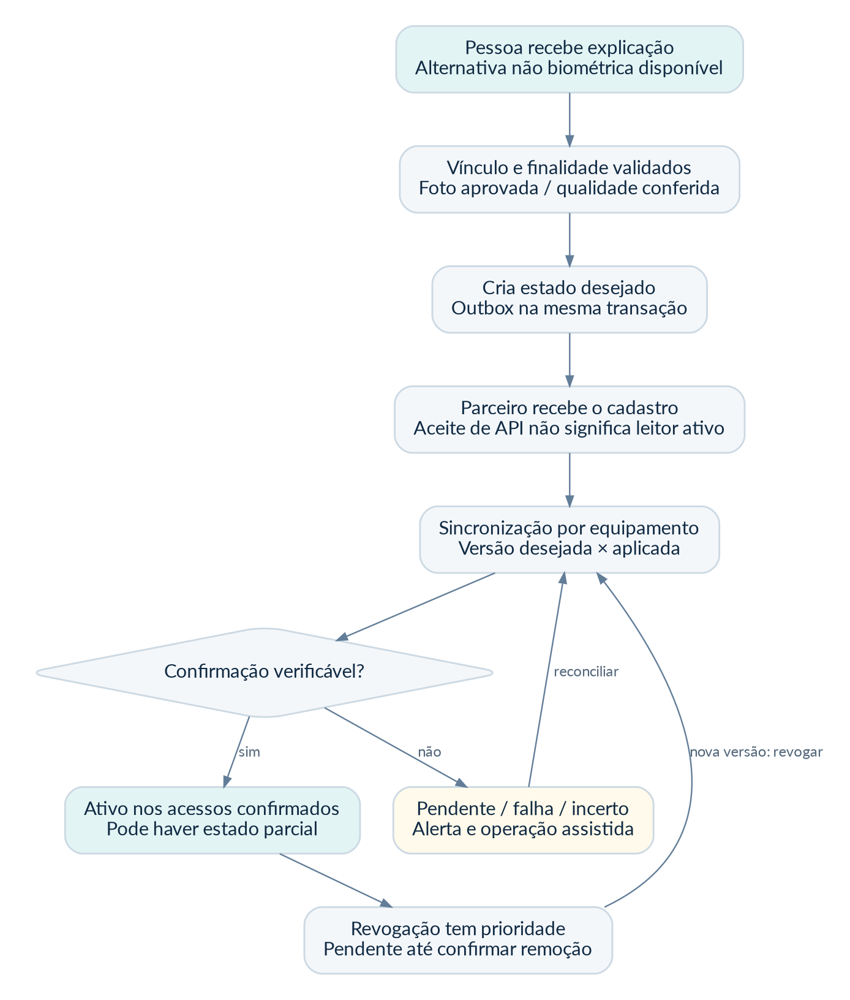

A estratégia inicial é integrar uma plataforma de controle de acesso com suporte contratual aos equipamentos. Bravas é candidata por evidências públicas de integração no segmento; não está contratada, não foi homologada para este projeto e a disponibilidade de sua API para novos parceiros precisa ser confirmada. [R20] Outros parceiros podem vencer a avaliação. Não inventar endpoints ou credenciais para “deixar pronto”.

O critério de escolha não é só quantidade de marcas. A proposta deve comprovar: cadastro/atualização; revogação; vigência; consulta de aplicação por dispositivo; eventos de acesso com direção e evidência; capacidade de operar localmente; segurança da comunicação; suporte; limites; cobrança; exportação; encerramento e tratamento dos dados.

| Gate de fornecedor | Evidência necessária antes do aceite |
| --- | --- |
| Contrato/API | Documentação atual, credenciais sandbox, autorização comercial e suporte nomeado |
| Modelos | Lista exata de controladora, leitor, firmware, versão e licenças |
| Cadastro | Foto aceita/rejeitada; retorno confiável; atualização não cria duplicata |
| Revogação | Exclusão/desativação efetiva; consulta de estado; reconciliação após offline |
| Eventos | IDs estáveis; distinção de autorização, acionamento e passagem; entrada/saída |
| Continuidade | Cadastros prévios funcionando conforme modo validado sem internet |
| Segurança | Conexões protegidas ou gateway local seguro; segredos por condomínio; nenhum port-forward público irrestrito |
| Privacidade | Finalidade, operadores/suboperadores, retenção, remoção e localização dos dados |
| Operação | SLA contratual, escalonamento, rollback físico e manutenção |
| Custo | Implantação, licença por condomínio/equipamento/usuário e excedentes |

A integração direta com Control iD é tecnicamente possível por API REST independente de linguagem. Ela é plano alternativo, não escopo paralelo do lançamento. Desenvolver várias marcas ao mesmo tempo aumenta suporte e amplia a matriz de homologação. [R09]

**Matriz mínima de testes físicos:** rosto aceito; foto ruim; identidade duplicada; expiração; revogação; leitor offline; controladora offline; queda de energia com retorno; internet intermitente; relógio divergente; troca de firmware; evento repetido; callback atrasado; cadastro parcialmente aplicado; reinício do worker; assinatura inválida; falha de sensor; saída não identificada; operação assistida.

Homologar por combinação de dispositivo, firmware, modo e instalação. “Compatível com Intelbras” ou “compatível com facial” não é um aceite. Foto capturada por câmera não garante prova de vida. Se o parceiro oferecer detecção de fraude, exigir documentação, limites e testes; não apresentá-la como infalível.

# 20. Contrato de integração, sincronização e contingência

O domínio usa uma interface própria `AccessProviderPort`: validar capacidades; registrar/alterar pessoa; enviar credencial; consultar aplicação; revogar; consultar eventos; verificar saúde; emitir comando autorizado quando habilitado. Um adaptador transforma esse contrato na API real do fornecedor. O arquivo de contrato entregue descreve a interface interna, não se passa pela documentação do parceiro.

Cada credencial possui `desired_version`, ação desejada e validade. Cada equipamento possui uma linha de sincronização com versão aplicada, resultado e instante da confirmação. “Ativo” só é mostrado quando os destinos exigidos confirmarem a versão atual. Um caso parcialmente aplicado mostra quais entradas estão prontas e quais precisam de assistência.

A resposta HTTP 200 do parceiro pode significar apenas recebimento. O adaptador mapeia explicitamente a semântica contratada. Se o parceiro não fornece confirmação por equipamento, a funcionalidade não pode prometer esse nível de certeza: o estado será “recebido pelo parceiro, aplicação não verificada”, e a implantação dependerá do procedimento acordado.

Revogações têm prioridade sobre novos cadastros. Uma confirmação antiga não reativa acesso revogado: respostas são comparadas com a versão desejada atual e descartadas como obsoletas quando necessário. Após indisponibilidade, reconciliar o estado final, não simplesmente reproduzir uma fila velha de “criar” e “excluir”.

**Repetição de chamadas:** tarefas de cadastro só repetem quando o provedor tem idempotência ou quando uma consulta confirma que não foram aplicadas. Timeout após envio gera estado UNKNOWN quando não há confirmação. Comandos de abertura têm validade curta, por exemplo 10 segundos configurados e homologados, e nunca entram em retry cego. Não executar abertura atrasada após a internet voltar. Abertura remota pelo morador permanece desabilitada no primeiro lançamento até análise específica.

**Rede:** priorizar gateway/solução local do parceiro, conexões de saída e acesso remoto protegido. Não expor a interface administrativa do leitor na internet. Equipamentos com HTTP local precisam ficar em rede segregada; não declarar criptografia ponta a ponta quando o último trecho não a suporta. Isolar VLAN, restringir IP e acesso de manutenção, revisar senhas padrão e relógio.

**Sem internet:** manter o modo local homologado para credenciais já sincronizadas, sem depender da nuvem para abrir cada porta. Fabricantes documentam modos autônomos e online com comportamentos diferentes. [R09, R11] Novos cadastros e revogações podem ficar pendentes. A portaria recebe orientação de contingência e, para bloqueio urgente, aciona o integrador/local conforme procedimento. Nenhum software deve interferir em saídas de emergência ou dispositivos de segurança de vida.

# 21. Eventos, filas e notificações sem falso positivo

O evento de negócio e sua entrada de outbox são persistidos na mesma transação. O worker busca lotes com lock e lease; processa fora da transação longa; registra tentativa, próximo horário e resultado. Se cair depois de executar uma ação externa e antes de marcar sucesso, o reprocessamento precisa ser seguro pelo contrato de idempotência.

Outbox não significa “exatamente uma vez”. A entrega é ao menos uma vez; consumidores têm chave e versão. Backoff inicial sugerido: 10 s, 30 s, 2 min, 10 min e 30 min, com jitter, respeitando limites do parceiro. Após limite definido, mover a tarefa para tratamento de falha visível. Operador pode reprocessar apenas quando a ação e o prazo permitirem.

Webhook: resolver conector por endpoint opaco previamente provisionado; validar assinatura no corpo original e janela de tempo; limitar tamanho; persistir inbox de forma durável; só então responder aceite. Não confiar em `tenant_id` enviado pelo parceiro sem correspondência com o conector conhecido. Quando o fornecedor não assina eventos, exigir transporte autenticado equivalente; filtro de IP sozinho não substitui autenticação.

SSE atualiza o painel web com eventos mínimos, contendo tipo e ID de recurso. Requisições de detalhe reaplicam permissão. Usar sessão segura, `Last-Event-ID`, heartbeat, limite por usuário e ressincronização. O cursor não autoriza acesso. Após cursor expirar, retornar instrução de recarga completa. Mobile em primeiro plano usa conexão suportada ou polling controlado; em segundo plano depende do canal de notificação.

No início, o Postgres mantém `ui_events` por destinatário e cursor. Cada instância da API busca eventos em lotes e entrega apenas às suas sessões autorizadas; a versão inicial pode usar polling interno curto. Não executar uma consulta pesada por cliente a cada segundo. Medir fan-out e considerar broker apenas quando necessário. A reconexão sempre consulta o estado oficial.

Push é um alerta, não fonte de verdade. Expo distingue ticket de envio e receipt do provedor; mesmo receipt positivo não comprova exibição no aparelho. [R12] Os estados do CondPulse serão QUEUED, SENT_TO_PROVIDER, PROVIDER_ACCEPTED, FAILED e READ_IN_APP, cada qual com evidência. Nenhum deles é autorização de entrada.

Push deve ser genérico na tela bloqueada: “Há uma atualização da portaria”; detalhes vêm após login. Remover tokens inválidos, deduplicar por evento/destinatário/canal e respeitar preferências. WhatsApp automático continua fora do lançamento. E-mail transacional requer domínio, autenticação e teste de entrega; SMS só após contratação específica.

# 22. Supabase, Coolify e topologia de implantação

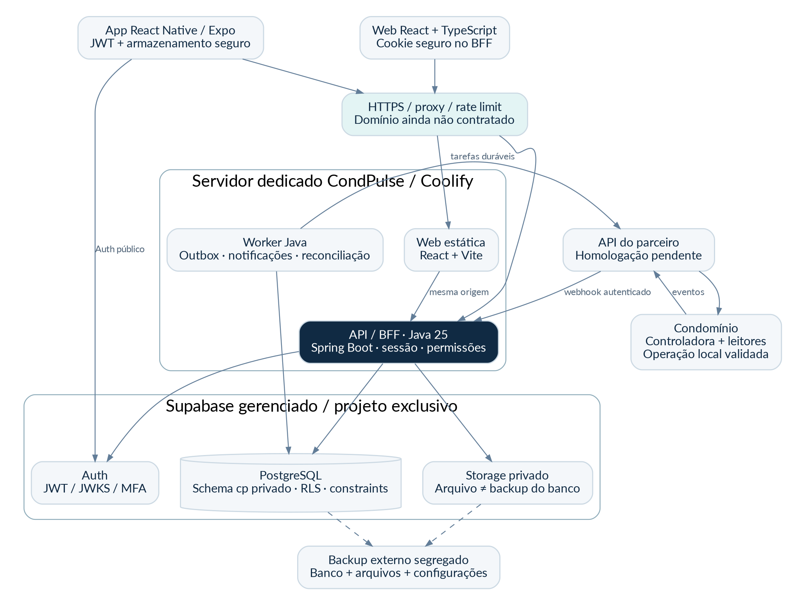

**Decisão inicial:** Supabase gerenciado em projeto exclusivo, selecionando explicitamente São Paulo quando disponível, e Coolify para aplicação em servidor dedicado do CondPulse. A documentação lista a região `sa-east-1`; escolher uma região genérica não garante Brasil. A localização do projeto não é prova de conformidade de todos os suboperadores. [R06]

Essa escolha evita instalar e manter toda a stack self-hosted de Auth, Storage e banco durante os 20 dias. Não reutiliza o Supabase antigo da Advanced nem presume que seu servidor Coolify tenha folga. O control plane Coolify já existente só pode administrar o novo servidor após revisão de segregação de acesso; não requer compartilhar containers, volumes ou credenciais de produção.

| Ambiente | Dados | Regras |
| --- | --- | --- |
| Local | Sintéticos, Postgres descartável | Sem segredo real ou banco de produção |
| Homologação | Supabase/projeto e buckets próprios | Mesmo schema e configuração relevante; sandbox do parceiro |
| Piloto/produção | Projeto e recursos exclusivos | Logs minimizados, MFA, backups, alertas e mudança aprovada |

Capacidade inicial de referência para medir: aplicação em host dedicado com 4 vCPU e 8 GB RAM, API com teto de memória, worker separado e builds fora do servidor de produção. Isso é hipótese de bancada, não dimensionamento confirmado nem orçamento do provedor. Reservar capacidade para o sistema operacional, proxy e observabilidade; alertar antes de memória/disco se esgotarem.

API não guarda sessão na memória da instância: BFF usa armazenamento de sessão durável, com refresh tokens criptografados por segredo externo ao banco. Conexões Postgres usam pool pequeno e TLS com validação; soma dos pools de API, worker, migração e suporte deve caber no limite contratado. Escolher conexão direta ou pooler de sessão após teste de rede. Não assumir que `LISTEN`, prepared statements e estado de sessão funcionam em pool transacional sem ajuste.

A aplicação pode começar em um host, explicitamente um ponto único de falha. Coolify não transforma um container em cluster automaticamente. [R07] Alta disponibilidade posterior exige segunda instância, balanceamento, estratégia de sessão, limites do banco e testes de failover. O piloto não deve vender SLA de alta disponibilidade sem essa arquitetura operada.

# 23. Segurança de aplicação e cadeia de entrega

A superfície de ameaça inclui conta comprometida, vínculo falso, acesso cruzado, convite compartilhado, câmera/leitor exposto, webhook forjado, funcionário curioso, upload malicioso, dupla operação e agente de IA com segredo de produção. O plano trata cada ameaça com controles e casos negativos.

| Ameaça | Controle | Evidência mínima |
| --- | --- | --- |
| IDOR entre unidades | Vínculo atual + escopo do recurso | Teste de trocar UUID em toda rota de leitura/alteração |
| Cache com tenant errado | Chave por contexto e limpeza na troca | E2E com uma conta em dois condomínios |
| JWT incorreto | Assinatura, issuer, audience, prazo, conta ativa | Tokens inválidos e de outro projeto rejeitados |
| Sessão web roubada | Cookie seguro, CSRF, CSP e MFA | Testes CSRF e revisão de headers |
| Foto/arquivo exposto | Bucket privado, ACL na API e URL curta | Tentativa de acesso sem vínculo falha |
| Segredo em repositório | Scanner, secret manager, sem `.env` real | Pipeline bloqueia fixture de segredo e log é saneado |
| Callback falso | Assinatura/transport security, replay e rate limit | Assinatura errada não cria evento |
| Reativação após revogação | Versão desejada e reconciliação | Resposta antiga não muda estado final |
| Dependência vulnerável | Lockfiles, SBOM e análise de dependências | Achados críticos tratados antes do gate |

Não armazenar segredos no banco de negócio: guardar referência ao cofre. Secret manager e contas administrativas têm MFA, acesso limitado e plano de recuperação. A rotação de uma credencial exige atualizar integração, testar e só então revogar a anterior quando o protocolo permitir; exposição confirmada exige contenção imediata e avaliação de impacto.

API usa validação por allowlist; DTOs não são entidades JPA serializadas diretamente. Proteger atribuição indevida de campos como role, tenant, approval e fee. Limitar exportação, upload, busca e login. Links externos não são buscados pelo backend sem proteção contra SSRF. Sanear HTML de avisos e proibir execução de scripts.

Agentes de IA usam dados sintéticos e acesso de menor privilégio. Não enviar faces, documentos de moradores, tokens ou dumps de produção a ferramentas de desenvolvimento. A revisão deve bloquear alteração de testes para “ficar verde”, remoção de constraints, desativação de RLS ou autenticação e mocks ativos em produção.

# 24. Privacidade, biometria e retenção

Biometria vinculada a uma pessoa é dado pessoal sensível. A base legal, finalidade, transparência, necessidade e direitos precisam ser analisados antes da coleta; um checkbox genérico não resolve a conformidade. A LGPD trata dados sensíveis e medidas de segurança em dispositivos próprios, e a ANPD destaca riscos de identificação incorreta e discriminação. [R15, R16]

Este capítulo é uma especificação de controles, não um parecer jurídico. Antes do piloto facial, designar controlador e operadores conforme a operação real, revisar contratos, registrar avaliação de impacto e aprovar a hipótese legal aplicável. Não escolher “legítimo interesse” de dados comuns como fundamento automático para biometria sensível. Fornecer alternativa de acesso não biométrico sem transformar exclusão em bloqueio arbitrário de morador.

Preferência técnica: foto enviada por fluxo do parceiro com destino e contrato aprovados; CondPulse recebe referência e estado. Se trânsito pelo Storage for inevitável, usar bucket dedicado privado, acesso mínimo, limite de tamanho, prazo e comprovação de exclusão. Não armazenar vetores faciais no banco CondPulse. Não usar a foto para treinar IA, publicidade ou identificação fora da finalidade contratada.

| Dado | Política inicial proposta para validar |
| --- | --- |
| Foto facial transitória | Excluir após confirmação, com teto operacional de 24 h; falha exige nova captura ou exceção justificada |
| Payload bruto de webhook | Até 7 dias, minimizado e criptografado quando contiver PII; guardar hash/normalizado quando possível |
| Eventos de acesso | 90 dias como ponto de partida de minimização, configurável e aprovado; não é prazo legal universal |
| Fotos de encomendas | Até 30 dias após retirada, salvo retenção justificada |
| Registro de retirada e reservas | Política contratual com finalidade e prazo aprovados antes do piloto |
| Sessões e idempotência | Apenas período operacional necessário; remover tokens ao encerrar sessão |
| Auditoria técnica | Janela definida por segurança e contrato; sem biometria nem corpo completo de requisição |
| Backups | Prazo explícito; expurgo propagado por ciclo documentado, com bloqueio de reativação após restore |

Para cada coleta, registrar finalidade, versão do aviso, base legal aprovada, destinatários, retenção e forma de exercer direitos. Consentimento, quando adotado, exige prova específica e tratamento da revogação. Não chamar todo esse registro de “consentimento” quando a base usada for outra.

Pedido de exclusão: confirmar identidade; localizar vínculos e registros; avaliar retenções legítimas; revogar credenciais; confirmar destinos; anonimizar/excluir o que couber; produzir resposta rastreável. Restaurar backup não pode reativar uma credencial revogada: aplicar o registro de revogações e reconciliar hardware antes de retomar integrações.

# 25. Observabilidade, desempenho e capacidade

**Objetivos iniciais de homologação, ainda não medidos:** leitura API p95 até 400 ms; comando transacional sem parceiro p95 até 800 ms; atualização da portaria p95 até 3 s após commit; envio ao provedor de notificação p95 até 10 s; transação de equipamento medida separadamente. O tempo total no celular depende de rede, renderização e provedores externos.

O ensaio inicial usa 20 condomínios, 200 unidades por condomínio e três contas por unidade como dados sintéticos, não como promessa comercial de capacidade. Executar carga com 1.000 sessões simultâneas, 100 requisições por segundo sustentadas e rajadas controladas. Variar leituras, reservas concorrentes, encomendas e webhooks. Ajustar a meta ao piloto real, reportando hardware, dataset, duração, erros e percentis.

| Sinal | Alerta inicial proposto |
| --- | --- |
| Taxa de erro API | Mais de 1% por 5 min, sem contar rejeições de negócio esperadas |
| Fila de revogações | Pendência online por mais de 60 s gera atenção; escalonamento conforme parceiro |
| Outbox mais antiga | Mais de 60 s para rotinas usuais; atraso persistente exige investigação |
| Falha de backup | Qualquer execução perdida; restore de amostra obrigatório |
| Memória/disco | Atenção a 75%, crítico a 85%, calibrado com a operação |
| Conector sem comunicação | Exibir idade da última confirmação; não chamar “conectado” eternamente |
| Isolamento | Qualquer acesso cruzado confirmado é incidente crítico |

Logs estruturados incluem trace, tenant técnico, ação, duração e resultado, mas não foto, token ou texto sensível. Métricas não usam nome de morador como label. Traces externos identificam o parceiro sem expor segredo. Um painel diferencia erro da aplicação, indisponibilidade de Auth, banco, push e hardware.

Spring Actuator expõe readiness/liveness internas; não publicar diagnóstico completo nem variáveis de ambiente. Health check não prova restauração de backup nem integridade da jornada. Coolify exige configuração de checks adequada à forma de deploy. [R17] Testes sintéticos de login/reserva/consulta e smoke tests complementam o monitoramento do processo.

# 26. Backup, restauração e continuidade

Backup do banco e backup de arquivos são processos diferentes. O Supabase informa que seus backups de banco não incluem os objetos armazenados pela Storage API. Portanto, restaurar o banco não restaura automaticamente uma foto ou documento removido do bucket. [R24]

A proposta exige cópia externa segregada, criptografia e restauração ensaiada. Não guardar a única cópia no mesmo disco da aplicação nem considerar snapshot de VM suficiente para todo o serviço. Configuração de Auth, políticas, secrets, buckets, versões de schema e permissões também entram no procedimento de recuperação.

| Escopo | Meta e mecanismo propostos | Condição de aceite |
| --- | --- | --- |
| Banco de produção | RPO até 15 min com PITR contratado/configurado ou solução equivalente comprovada | Restore para instante escolhido; validar tenant, reserva e outbox |
| Arquivos ordinários | Cópia/versionamento externo; RPO até 1 h conforme ferramenta contratada | Restaurar objeto, conferir hash, ACL e vínculo |
| Configuração | A cada release + inventário de segredos em cofre | Reconstruir host sem copiar máquina manualmente |
| Tempo de retorno | RTO até 4 h na topologia inicial | Medição em exercício; não apenas estimativa |
| Facial | Inventário e estado desejado, não uma coleção desnecessária de faces | Reconciliar com parceiro; nunca recriar credencial revogada |

Apenas backup diário implica janela de perda potencial de aproximadamente um dia, e não 15 minutos. Se o custo de PITR não estiver aprovado, a operação não pode anunciar esse RPO. O responsável deve aprovar formalmente uma alternativa de piloto ou adiar o gate de produção. Não há preços de infraestrutura contratados neste documento.

Procedimento de restore: congelar escritas e conectores; escolher ponto de recuperação; restaurar em ambiente novo; reconfigurar roles e segredos; recuperar arquivos; validar checksums e contagens; aplicar revogações posteriores ao ponto restaurado a partir do registro de incidente; reconciliar reservas, handoffs e credenciais; executar smoke tests; liberar tráfego; retomar workers com proteção contra repetição; registrar tempos e divergências.

Testar restauração antes do primeiro piloto e mensalmente no início. Retenção proposta de backups: 7 diários e 4 semanais para cópias externas, ajustada ao plano de privacidade e ao custo; retenção de PITR conforme contratação. Apagamento no sistema ativo pode persistir no backup até o ciclo de expurgo, mas o procedimento não deve reintroduzir dados ou acesso de forma indevida.

# 27. Implantação, migração e corte de operação

Uma implantação começa com diagnóstico, não com importação cega. Registrar quantidade de unidades, pessoas, áreas, reservas, encomendas e autorizações. Identificar proprietários, ocupantes e contatos desatualizados. Importações não devem atribuir permissões administrativas a partir de um texto livre em planilha.

**Procedimento padrão:** preparar modelo CSV; mapear colunas; validar em staging; produzir prévia com erros por linha; revisar duplicatas e vínculos; confirmar lote; importar de maneira idempotente; emitir relatório de reconciliação; obter aceite local; enviar convites; acompanhar ativação. Nome de bloco e número de unidade não são chaves suficientes para mesclar registros de origens diferentes.

O lote guarda arquivo original privado, hash, origem, operador, mapeamento, versão, linhas aceitas/rejeitadas e IDs externos. A confirmação não permite “parcial silencioso”. Operador escolhe corrigir ou aprovar explicitamente um lote parcial com relatório. Reprocessar o mesmo arquivo não duplica pessoas, reservas ou encomendas.

| Momento | Ação e evidência |
| --- | --- |
| T−7 dias | Diagnóstico funcional, contrato e inventário físico |
| T−3 dias | Importação ensaio; cadastro de áreas; treinamento de responsáveis |
| T−1 dia | Conferir reservas futuras, encomendas pendentes e todos os turnos |
| Corte | Definir horário e um sistema oficial por processo; interromper dupla escrita |
| T+1 dia | Reconciliar movimentações e atender dúvidas na portaria |
| T+3 dias | Revisar adesão, erros e suporte; decidir expansão |
| Encerramento anterior | Só depois de estabilidade, acesso ao histórico e continuidade física comprovados |

Se o aplicativo antigo também fornece boletos ou portaria remota, essa função continua no fornecedor responsável até existir substituição contratada. Não cancelar serviço apenas porque as reservas migraram. Para facial, manter rota física de rollback validada pelo integrador; não deixar dois sistemas concorrentes alterando a mesma controladora sem coordenação.

Treinamento deve cobrir todos os turnos, substitutos e responsáveis, com demonstração de falhas: internet indisponível, morador sem push, código inválido, reserva pendente e leitor não sincronizado. A folha de continuidade da portaria precisa existir fora do sistema, sem expor lista desnecessária de dados pessoais.

# 28. CI/CD, versões e política de mudanças

O repositório é novo e exclusivo. A proposta usa GitHub para código e Woodpecker como executor preferencial, sujeito a verificar instalação, capacidade e isolamento. Não pressupõe que o runner Advanced esteja disponível. Testes de pull requests não recebem segredos de produção. Builds acontecem fora do host da aplicação.

Pipeline mínimo: lint/format; compilação; testes unitários; testes de arquitetura; PostgreSQL/Testcontainers; validação OpenAPI; geração do cliente; testes de contrato; análise de dependências; secrets scan; imagem de container; SBOM; staging; smoke test; aprovação; deploy de produção; verificação pós-release. Um badge verde só vale se os comandos correspondentes rodaram e seus relatórios existirem.

Versões de Java, Spring, Node, gerenciador de pacotes, Expo e demais dependências ficam pinadas em manifests e lockfiles. Não usar `latest` nas imagens de produção. Dependências introduzidas por IA precisam existir no repositório oficial, ter licença compatível e versão real. O Spring consultado declara compatibilidade com Java 25; o conjunto de bibliotecas escolhido ainda precisa de build e testes. [R01]

Migração usa **expandir, migrar, contrair**: primeiro adicionar estrutura compatível; implantar código que lê ambos quando necessário; migrar dados; remover estrutura antiga em release posterior. Não fazer rollback de banco com script destrutivo automático. Rollback de aplicação usa imagem anterior compatível com o schema; quando não for compatível, executar o plano de correção previsto.

Deploy: rodar migration job com credencial separada; subir API; readiness; smoke por tenant sintético; encaminhar tráfego; subir worker; observar erros e fila; liberar usuários. Mudança de credencial/contrato facial exige sandbox e janela com integrador. Features por tenant são controladas no servidor e auditadas.

Aplicativos nativos precisam de conta de desenvolvedor, assinatura, política de privacidade, informações de coleta, revisão e distribuição. Essas aprovações externas não estão sob controle do código. Submeter cedo; usar distribuição piloto adequada enquanto a revisão ocorre. Não prometer presença nas lojas no D20 sem aprovação efetiva.

# 29. Fases de execução: D0 ao D20

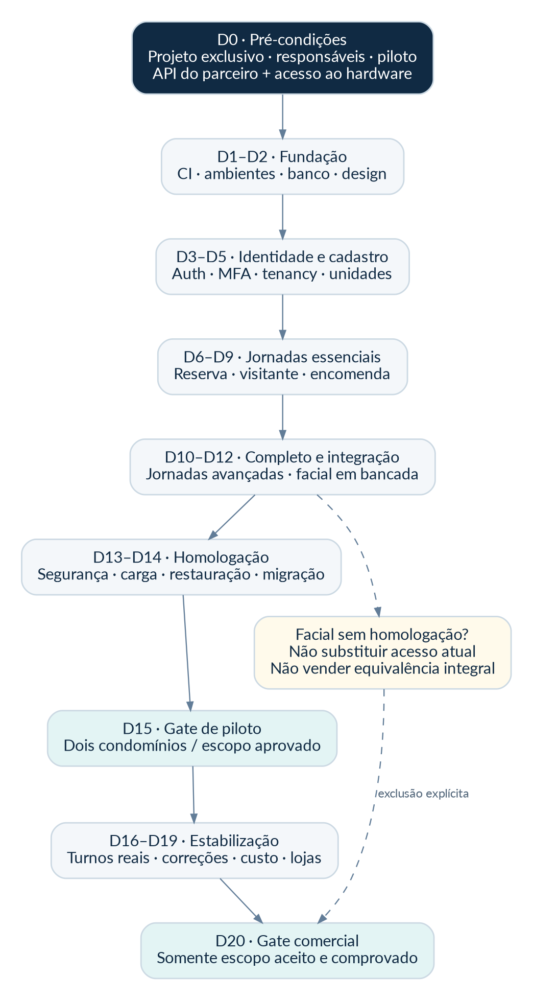

D1 é o primeiro dia com repositório, ambientes, responsáveis e acesso às dependências disponíveis. A meta pressupõe frentes paralelas, revisão diária e decisões rápidas. Com início em 27/10/2026 e dias corridos inclusivos, D15 seria 10/11/2026 e D20 seria 15/11/2026; as datas são exemplo, não execução agendada.

| Fase | Entregas verificáveis | Gate |
| --- | --- | --- |
| D0 | Repositório; dono técnico; projetos; orçamento; piloto; API/hardware disponíveis; privacidade | Sem isso, não iniciar a contagem como se a dependência estivesse resolvida |
| D1–D2 | Scaffold; versões; CI; ambientes; SQL de referência; design system; contratos | Build reproduzível, migrações em ambiente descartável e dependências externas confirmadas |
| D3–D5 | Auth web/mobile, MFA, tenancy, unidades, vínculos, importação e arquivos | Login real e dois tenants isolados; recuperação e revogação verificadas |
| D6–D9 | Reservas, visitantes, chegadas, encomendas, avisos, pedidos, push e portaria | Conflito de horário, primeira decisão e retirada única testados; mesmas fontes nas interfaces |
| D10–D12 | Recursos do Completo e facial na bancada | Cadastro/revogação; eventos; offline; matriz por equipamento |
| D13–D14 | Segurança; carga; restauração; migração ensaio; dispositivos reais | Nenhuma falha crítica; evidências arquivadas |
| D15 | Piloto controlado: um sem sistema e um com troca social | Todos os turnos aptos; operação anterior preservada se houver dependência |
| D16–D19 | Correções, adesão, custo de suporte e homologação restante | Estabilização e termo de aceite |
| D20 | Decisão comercial e publicação do escopo aceito | Sem bloqueadores; funcionalidades pendentes não são vendidas |

**Caminho crítico:** identidade → tenancy → contrato API → banco → reserva/visita/encomenda → portaria/notificações → migração → piloto. A trilha facial é paralela, mas depende do parceiro e de teste físico desde D0. Deixá-la para D15 inviabiliza comprovar substituição integral.

**Plano de redução de escopo:** não cortar isolamento, auditoria, recuperação, backup ou testes concorrentes. Cortar primeiro OCR, IA, câmeras, integrações extras e personalizações. Se P1 não terminar, vender somente o escopo aprovado; não chamar Essencial de Completo. Para condomínio com facial, adiar a troca integral, mantendo o fornecedor e a operação atuais.

# 30. Estratégia de testes e critérios de aceite

Teste de produto é evidência, não uma intenção. Cada requisito crítico recebe caso automatizado, responsável, ambiente, resultado e link para relatório. A cobertura de linhas é auxiliar; não substitui a execução do cenário.

| Categoria | Casos obrigatórios |
| --- | --- |
| Identidade | OTP/link expirado; MFA ausente; token de outro projeto; usuário desligado; convite reutilizado |
| Isolamento | Tenant A tentando ler/escrever B; morador de unidade diferente; arquivo e SSE cruzados; worker sem contexto |
| Reservas | 50 tentativas concorrentes; buffer; cota por unidade; aprovação vencida; fila; bloqueio de manutenção |
| Acesso | Decisões simultâneas; ausência de resposta; recorrência fora da janela; revogação e callback antigo |
| Encomendas | Duas retiradas simultâneas; delegação expirada; código em brute force; unidade incorreta |
| Integração | Timeout após execução; webhook repetido/forjado; indisponibilidade; retry; resposta fora de ordem |
| Experiência | 360 px; zoom; teclado; leitor de tela; rede lenta; sessão vencida; nome longo; estado vazio |
| Operação | Restore completo; segredo rotacionado; rollback de aplicação; host indisponível; fila atrasada |
| Mobile | Android/iOS reais; câmera negada; push negado; app fechado; logout; atualização; deep link inválido |

Ferramentas propostas: JUnit, Testcontainers/PostgreSQL, testes de arquitetura com ArchUnit, WireMock ou equivalente para fornecedor, Playwright para web, testes nativos/E2E compatíveis com Expo e carga com k6. Fixar versões reais no D1; não introduzir ferramentas duplicadas para a mesma finalidade.

**Gate piloto:** 100% dos P0 entregues e testados; zero vulnerabilidade crítica conhecida sem mitigação aceita; zero exposição entre tenants; zero dupla reserva/retirada nos ensaios; restauração concluída; plantão e contingência definidos; contratos e responsáveis de dados aprovados; pelo menos um fluxo completo por turno validado.

**Gate facial:** não basta sandbox. Exigir evidência do leitor real para cadastrar, reconhecer, revogar, expirar e operar conforme o modo local; comparar eventos e direção; verificar pendência parcial; registrar modelos e firmware. Qualquer teste de “abrir porta” deve ser autorizado e acompanhado no local.

**Gate comercial:** escopo por pacote demonstrado; custos e limites conhecidos; migração ensaiada; contratos preparados; suporte ativo; roteiro de saída e portabilidade. Manter status “não executado” para testes que ainda não ocorreram. A validação deste pacote documental não substitui nenhum desses gates.

# 31. Operação e runbooks de incidentes

| Cenário | Primeira resposta | Continuidade e recuperação |
| --- | --- | --- |
| API indisponível | Verificar monitor externo, proxy, processo e banco; não reiniciar tudo cegamente | Portaria segue procedimento aprovado; restaurar instância; reconciliar registros |
| Internet no condomínio caiu | Mostrar dados antigos e interromper confirmações online | Operação local homologada/interfone; registrar ações assistidas e reconciliar depois |
| Revogação facial pendente | Marcar alerta com equipamentos afetados e acionar integrador | Não afirmar “bloqueado”; executar contingência local e confirmar remoção |
| Push não chegou | Conferir ticket/receipt, permissão e token | Portaria usa canal alternativo permitido; nenhuma aprovação presumida |
| Dupla reserva suspeita | Bloquear novas alterações da área, preservar logs | Conferir constraint/schema e origem; resolver com gestão; não apagar evidência |
| Vazamento de segredo | Conter, revogar/rotacionar, revisar usos e preservar registros | Avaliar dados e impacto; acionar responsável por privacidade; comunicar conforme obrigação aplicável |
| Restore necessário | Suspender escritas e comandos físicos | Restaurar ambiente novo, validar, aplicar revogações, reconciliar e liberar gradualmente |

Classificar incidentes: P0 para acesso indevido, exposição entre tenants ou impossibilidade generalizada de operar com risco; P1 para jornada importante indisponível com contingência; P2 para falha localizada; P3 para melhoria. O contrato define tempos de atendimento realistas. A equipe de software não se apresenta como central humana 24 h se esse serviço não foi contratado.

Registro de incidente inclui início, descoberta, impacto, tenants afetados, decisões, responsável, evidência, comunicação, recuperação e ação preventiva. Após falha, corrigir causa e teste de regressão, não apenas o dado visível. Logs e evidências têm acesso limitado.

# 32. Custos, limites e viabilidade dos dois pacotes

Este documento não inclui orçamento contratado de nuvem ou parceiro. Mensalidade do software não é lucro. A conta por condomínio precisa considerar custo compartilhado alocado, suporte, implantação amortizada, uso variável, tributos e margem.

**Modelo:** margem de contribuição = mensalidade − impostos/taxas variáveis − licença do parceiro − mensagens/armazenamento incremental − suporte variável − custo de infraestrutura alocado. Desenvolvimento, comercial e administração vêm depois na análise de resultado. Não esconder trabalho humano em uma estimativa “só de servidor”.

| Premissa ilustrativa | Essencial | Completo |
| --- | --- | --- |
| Receita nominal | R$ 249 | R$ 499 |
| Limite interno proposto de custo direto de 35% | R$ 87,15 | R$ 174,65 |
| Uso do limite | Meta de planejamento, não custo apurado | Pode ser inviável com licença/hardware caro; revisar antes de oferecer |

A regra de 35% é uma hipótese gerencial escolhida para simulação. Não é padrão de mercado. O pacote inclui os usuários das unidades contratadas dentro do porte validado, sem bloquear artificialmente membros de uma família para reduzir custo. Definir em contrato o porte, áreas e volume operacional atendidos; condomínios fora do perfil passam por dimensionamento, mantendo dois pacotes.

Métricas por tenant: usuários ativos, eventos de acesso, notificações, bytes de documentos, consumo de banco, minutos de suporte e horas de implantação. Alertas de consumo não desligam silenciosamente recursos de segurança. Um downgrade ou cancelamento exige plano de retirada da funcionalidade, exportação e continuidade física.

# 33. Registro de decisões de arquitetura

| ADR | Decisão | Consequência / condição para rever |
| --- | --- | --- |
| ADR-01 | CondPulse separado da Advanced | Integração por contrato; não compartilhar banco ou Auth |
| ADR-02 | Java/Spring, não alternar linguagem no meio do projeto | Revisão só com protótipo e justificativa de custo/risco |
| ADR-03 | Monólito modular com API e worker | Evita operação de muitos serviços; extração posterior por medição |
| ADR-04 | Supabase gerenciado dedicado no início | Menos operação no prazo; custo e PITR precisam de aprovação |
| ADR-05 | React web + React Native/Expo | Compartilhar contratos/tokens, não todas as telas |
| ADR-06 | RLS de tenant + autorização de negócio na API | Ambos precisam de testes; cliente não acessa tabelas cp |
| ADR-07 | Um parceiro de acesso primeiro | Compatibilidade por modelo/firmware, não marca genérica |
| ADR-08 | Reconhecimento e decisão local no modo homologado | Novas mudanças offline ficam pendentes; contingência explícita |
| ADR-09 | Outbox/inbox transacionais | Entrega repetível; efeitos externos exigem idempotência |
| ADR-10 | Sem motor de IA no caminho crítico | Operação funciona sem LLM, OCR ou resposta generativa |
| ADR-11 | Estados confirmados por evidência | “Enviado” não equivale a “entrou”, “lido” ou “ativo” |
| ADR-12 | Nenhuma promessa de escala infinita ou falha zero | Capacidade e confiabilidade são medidas nos gates |

# 34. Riscos e decisões ainda pendentes

| ID | Risco / pendência | Responsável e ação |
| --- | --- | --- |
| RSK-01 | API/licença do parceiro não disponível | Produto + integrador; resolver no D0 ou retirar facial da promessa de prazo |
| RSK-02 | Equipamento atual incompatível | Inventário e bancada; não cancelar fornecedor existente |
| RSK-03 | Foto aprovada mas cadastro não aplicado | Estado por dispositivo e reconciliação; teste com leitor desconectado |
| RSK-04 | Prazo de lojas extrapola 20 dias | Submeter cedo; piloto adequado; não anunciar publicação antes da aprovação |
| RSK-05 | Código gerado sem teste real | PRs pequenos, revisão independente e evidências de execução |
| RSK-06 | Supabase/PITR ou suporte inviabiliza margem | Apurar custo por tenant; revisar contrato e dimensionamento |
| RSK-07 | Falha da única VM | Explicitar topologia inicial; restore ensaiado; HA antes de SLA superior |
| RSK-08 | Dados importados sem qualidade | Prévia, reconciliação e aceite do responsável |
| RSK-09 | Uso inadequado de biometria/monitoramento doméstico | Política de visibilidade, base legal e alternativa não biométrica |
| RSK-10 | Migração reintroduz acesso revogado | Registro de revogações e reconciliação após restore |

Pendências concretas no momento da entrega: repositório e equipe não provisionados por este pacote; domínio não comprado; fornecedor facial não escolhido; modelos/firmwares não inventariados; orçamento não contratado; projetos Supabase/Coolify não criados; contas de lojas não verificadas; pilotos não selecionados; base legal/contratos não aprovados. São pré-condições visíveis, não tarefas consideradas concluídas.

# 35. Modo de trabalho dos agentes de IA

O arquivo `handoff/AGENTS.md` é a regra de execução do repositório. O agente coordenador lê o PRD, registra versões e trabalha por ticket. Um agente implementa, outro revisa contrato, segurança e testes. O coordenador integra apenas após evidência objetiva. Não haverá dois agentes alterando a mesma migration sem coordenação.

Cada ticket deve informar requisito, arquivos afetados, decisão de arquitetura, migração, testes executados, resultado, limitação e próximo passo. Comentários como “deve funcionar” ou “testes provavelmente passam” não são aceite. Se o ambiente não permite executar um teste, registrar “não executado” e o comando de reprodução; não substituí-lo por um mock e chamar de integração real.

Não alterar produção nesta etapa documental. Depois de provisionado, alterações de infraestrutura, segredos, migrações destrutivas, acesso físico e publicação comercial exigem a aprovação prevista. O agente não deve usar dados de produção para preencher o protótipo. Todo fixture traz indicação de dados fictícios.

Começar por uma fatia vertical: login → tenant/unidade → área → reserva → evento → atualização da portaria. Ela fixa padrões de DTO, transação, erro, auditoria, autorização e teste. Depois, replicar o padrão nos módulos, evitando que cada IA invente uma arquitetura própria.

# 36. Como usar o pacote entregue

1. Ler o README do pacote e este PRD; confirmar decisões e pendências do D0.
2. Entregar `handoff/PROMPT_INICIAL.md` ao agente coordenador, junto do pacote completo.
3. Criar o repositório exclusivo e copiar os contratos, migrations de referência, tokens e regras de agentes.
4. Validar SQL em banco descartável; revisar roles/RLS; gerar cliente da API; fixar versões.
5. Executar os tickets na ordem do backlog; atualizar estados com evidências reais.
6. Realizar gates técnico, privacidade, físico e operacional antes de comercializar o escopo correspondente.

O ZIP contém material de implementação e ativos, não código de aplicação completo. Não existe endpoint publicado nem teste de carga/segurança de produção executado por esta entrega. As validações documentais e estruturais efetivamente realizadas são registradas em `qualidade/RELATORIO_VALIDACAO.md`.

A seção seguinte consolida dicionário de dados, backlog de implementação, catálogo de endpoints, casos de aceite e referências. Os arquivos técnicos separados preservam detalhe suficiente para trabalhar sem copiar trechos de PDF.

# 37. Dicionário de dados inicial

Todos os registros `cp` têm ID, tenant e criação. Entidades mutáveis têm atualização e versão; tabelas de evidência são append-only para as roles de aplicação. O SQL contém tipos, checks, índices e relações. `platform.accounts`, `platform.tenants` e `platform.web_sessions` completam a camada técnica.

## 37.1. blocks

Blocos do condomínio.

 | Campo | Tipo / finalidade |
 | --- | --- |
 | `name` | text — Nome do bloco |

## 37.2. units

Unidades residenciais/comerciais.

 | Campo | Tipo / finalidade |
 | --- | --- |
 | `block_id` | uuid — Bloco, quando existir |
 | `label` | text — Identificação da unidade |
 | `status` | text — Estado operacional |

## 37.3. memberships

Vínculos e permissões por unidade ou função.

 | Campo | Tipo / finalidade |
 | --- | --- |
 | `account_id` | uuid — Subject de Auth |
 | `unit_id` | uuid — Unidade; nulo para equipe |
 | `display_name` | text — Nome exibido no contexto |
 | `role` | text — Papel |
 | `permissions` | jsonb — Capacidades validadas pelo serviço |
 | `status` | text — Validação |
 | `valid_from` | timestamptz — Início |
 | `valid_until` | timestamptz — Fim |

## 37.4. subscriptions

Plano e recursos contratados.

 | Campo | Tipo / finalidade |
 | --- | --- |
 | `plan` | text — Plano |
 | `state` | text — Contrato; não bloqueia portão por dívida |
 | `features` | jsonb — Flags controladas no servidor |
 | `starts_at` | timestamptz — Início |
 | `ends_at` | timestamptz — Fim |

## 37.5. amenities

Áreas reserváveis e regras.

 | Campo | Tipo / finalidade |
 | --- | --- |
 | `name` | text — Nome público |
 | `capacity` | integer — Capacidade informativa |
 | `approval_required` | boolean — Aprovação |
 | `fee_cents` | bigint — Taxa em centavos |
 | `buffer_minutes` | integer — Limpeza |
 | `policy_version` | integer — Versão de regras |
 | `policy` | jsonb — Horários/cotas/antecedência com schema validado |
 | `active` | boolean — Disponibilidade do cadastro |

## 37.6. reservations

Reservas e bloqueios no mesmo mecanismo anti-conflito.

 | Campo | Tipo / finalidade |
 | --- | --- |
 | `amenity_id` | uuid — Área |
 | `unit_id` | uuid — Unidade; obrigatória em BOOKING |
 | `created_by` | uuid — Ator |
 | `kind` | text — Reserva ou manutenção |
 | `status` | text — Estado |
 | `starts_at` | timestamptz — Início de uso |
 | `ends_at` | timestamptz — Fim de uso |
 | `occupied_from` | timestamptz — Início efetivo com buffer |
 | `occupied_until` | timestamptz — Fim efetivo com buffer |
 | `expires_at` | timestamptz — Expiração de hold/aprovação |
 | `rule_snapshot` | jsonb — Regras aceitas |
 | `fee_cents` | bigint — Taxa registrada |
 | `decision_reason` | text — Motivo de decisão/cancelamento |

## 37.7. reservation_waitlist

Fila de espera e oferta temporária.

 | Campo | Tipo / finalidade |
 | --- | --- |
 | `amenity_id` | uuid — Área |
 | `unit_id` | uuid — Unidade |
 | `account_id` | uuid — Solicitante |
 | `starts_at` | timestamptz — Período desejado |
 | `ends_at` | timestamptz — Fim |
 | `state` | text — Fila |
 | `offer_reservation_id` | uuid — Hold correspondente |
 | `offer_expires_at` | timestamptz — Prazo da oferta |

## 37.8. reservation_fee_entries

Encaminhamento de taxa, sem presumir pagamento.

 | Campo | Tipo / finalidade |
 | --- | --- |
 | `reservation_id` | uuid — Reserva |
 | `amount_cents` | bigint — Centavos |
 | `state` | text — Estado |
 | `external_reference` | text — Comprovante da administração |

## 37.9. visitors

Identidade mínima de visitante por tenant.

 | Campo | Tipo / finalidade |
 | --- | --- |
 | `full_name` | text — Nome |
 | `document_last4` | text — Somente final quando necessário |
 | `document_fingerprint` | text — HMAC opcional, não hash simples de CPF |
 | `contact_ciphertext` | bytea — Contato cifrado quando necessário |
 | `retention_until` | timestamptz — Prazo de retenção |

## 37.10. visit_permits

Autorizações temporais e recorrentes.

 | Campo | Tipo / finalidade |
 | --- | --- |
 | `visitor_id` | uuid — Visitante |
 | `unit_id` | uuid — Destino |
 | `reservation_id` | uuid — Evento opcional |
 | `created_by` | uuid — Autor |
 | `state` | text — Estado |
 | `valid_from` | timestamptz — Início |
 | `valid_until` | timestamptz — Fim obrigatório |
 | `schedule` | jsonb — Recorrência validada no fuso do tenant |
 | `public_token_hash` | text — Hash do token compartilhável |
 | `single_use` | boolean — Política de uso |
 | `revoked_at` | timestamptz — Revogação |

## 37.11. permit_windows

Janelas materializadas de uma recorrência.

 | Campo | Tipo / finalidade |
 | --- | --- |
 | `permit_id` | uuid — Autorização |
 | `starts_at` | timestamptz — Início |
 | `ends_at` | timestamptz — Fim |
 | `state` | text — Estado |
 | `used_at` | timestamptz — Uso |

## 37.12. arrival_requests

Pedido de decisão por chegada específica.

 | Campo | Tipo / finalidade |
 | --- | --- |
 | `visitor_id` | uuid — Pessoa |
 | `unit_id` | uuid — Destino |
 | `permit_id` | uuid — Convite opcional |
 | `created_by` | uuid — Porteiro |
 | `state` | text — Estado |
 | `expires_at` | timestamptz — Prazo |
 | `decided_by` | uuid — Ator da decisão |
 | `decided_at` | timestamptz — Momento |
 | `decision_source` | text — Aplicativo ou procedimento assistido |

## 37.13. parcels

Recebimento e guarda de encomendas.

 | Campo | Tipo / finalidade |
 | --- | --- |
 | `unit_id` | uuid — Destino |
 | `received_by` | uuid — Operador |
 | `description` | text — Descrição curta |
 | `quantity` | integer — Quantidade |
 | `storage_location` | text — Local físico |
 | `state` | text — Estado |
 | `received_at` | timestamptz — Recebimento |

## 37.14. parcel_delegations

Pessoa autorizada a retirar uma encomenda.

 | Campo | Tipo / finalidade |
 | --- | --- |
 | `parcel_id` | uuid — Encomenda |
 | `created_by` | uuid — Morador |
 | `delegate_name` | text — Pessoa indicada |
 | `code_hmac` | text — Código protegido com segredo |
 | `expires_at` | timestamptz — Validade |
 | `state` | text — Estado |
 | `failed_attempts` | integer — Tentativas |

## 37.15. parcel_handoffs

Evidência única de retirada.

 | Campo | Tipo / finalidade |
 | --- | --- |
 | `parcel_id` | uuid — Encomenda |
 | `delegation_id` | uuid — Autorização opcional |
 | `operator_id` | uuid — Porteiro |
 | `recipient_name` | text — Recebedor conferido |
 | `handed_at` | timestamptz — Horário |
 | `evidence_type` | text — Origem da confirmação |

## 37.16. announcements

Avisos publicados e segmentação.

 | Campo | Tipo / finalidade |
 | --- | --- |
 | `title` | text — Título |
 | `body` | text — Texto sem scripts |
 | `audience` | jsonb — Segmentação validada |
 | `state` | text — Estado |
 | `published_at` | timestamptz — Publicação |
 | `author_id` | uuid — Autor |

## 37.17. announcement_reads

Leitura autenticada de aviso.

 | Campo | Tipo / finalidade |
 | --- | --- |
 | `announcement_id` | uuid — Aviso |
 | `account_id` | uuid — Leitor |
 | `read_at` | timestamptz — Abertura autenticada |

## 37.18. service_requests

Pedidos acompanháveis do morador.

 | Campo | Tipo / finalidade |
 | --- | --- |
 | `unit_id` | uuid — Unidade |
 | `requester_id` | uuid — Autor |
 | `category` | text — Categoria validada |
 | `title` | text — Título |
 | `description` | text — Descrição |
 | `state` | text — Andamento |
 | `assigned_to` | uuid — Responsável |
 | `desired_window` | tstzrange — Mudança/entrega |
 | `external_ref` | text — Integração futura |

## 37.19. request_messages

Mensagens do atendimento.

 | Campo | Tipo / finalidade |
 | --- | --- |
 | `request_id` | uuid — Pedido |
 | `author_id` | uuid — Autor |
 | `body` | text — Texto |
 | `visibility` | text — Destinatários |

## 37.20. attachments

Metadados de arquivo privado.

 | Campo | Tipo / finalidade |
 | --- | --- |
 | `owner_id` | uuid — Dono |
 | `unit_id` | uuid — Escopo de unidade |
 | `purpose` | text — Uso autorizado |
 | `entity_type` | text — Agregado; vínculo validado no serviço |
 | `entity_id` | uuid — Recurso associado |
 | `bucket` | text — Bucket privado |
 | `object_key` | text — Chave interna |
 | `sha256` | text — Integridade |
 | `mime_type` | text — Tipo conferido |
 | `size_bytes` | bigint — Tamanho |
 | `state` | text — Liberação |
 | `retention_until` | timestamptz — Expurgo |

## 37.21. connectors

Conexão por condomínio com parceiro.

 | Campo | Tipo / finalidade |
 | --- | --- |
 | `provider_code` | text — Fornecedor escolhido |
 | `mode` | text — Ambiente |
 | `secret_ref` | text — Referência a cofre, não segredo |
 | `configuration` | jsonb — Configuração validada e sem segredo |
 | `state` | text — Estado |
 | `last_confirmed_at` | timestamptz — Última comunicação verificada |

## 37.22. access_devices

Equipamentos homologados e sua condição.

 | Campo | Tipo / finalidade |
 | --- | --- |
 | `connector_id` | uuid — Conector |
 | `external_id` | text — ID no parceiro |
 | `label` | text — Nome operacional |
 | `model` | text — Modelo exato |
 | `firmware` | text — Firmware homologado |
 | `direction` | text — Direção identificável |
 | `capabilities` | jsonb — Operações verificadas |
 | `last_seen_at` | timestamptz — Comunicação |

## 37.23. legal_records

Prova de finalidade/base legal/aviso.

 | Campo | Tipo / finalidade |
 | --- | --- |
 | `account_id` | uuid — Titular com conta |
 | `visitor_id` | uuid — Titular visitante |
 | `purpose` | text — Finalidade |
 | `legal_basis` | text — Base aprovada, não texto gerado automaticamente |
 | `notice_version` | text — Aviso apresentado |
 | `recorded_at` | timestamptz — Momento |
 | `evidence_ref` | text — Evidência mínima |
 | `withdrawn_at` | timestamptz — Quando aplicável |

## 37.24. access_credentials

Estado desejado de credencial, sem template facial.

 | Campo | Tipo / finalidade |
 | --- | --- |
 | `connector_id` | uuid — Conector |
 | `account_id` | uuid — Morador |
 | `visitor_id` | uuid — Visitante |
 | `permit_id` | uuid — Permissão temporal |
 | `legal_record_id` | uuid — Finalidade/aviso aprovado |
 | `provider_person_ref` | text — Identificador no parceiro |
 | `kind` | text — Tipo |
 | `desired_state` | text — Intenção atual |
 | `desired_version` | bigint — Versão monotônica |
 | `valid_until` | timestamptz — Expiração |
 | `status` | text — Resumo derivado |

## 37.25. credential_syncs

Confirmação por credencial e equipamento.

 | Campo | Tipo / finalidade |
 | --- | --- |
 | `credential_id` | uuid — Credencial |
 | `device_id` | uuid — Leitor/controladora |
 | `desired_version` | bigint — Versão esperada |
 | `observed_version` | bigint — Versão aplicada |
 | `state` | text — Situação confirmável |
 | `confirmed_at` | timestamptz — Verificação |
 | `provider_reference` | text — Prova externa |
 | `last_error_code` | text — Erro saneado |

## 37.26. integration_commands

Comandos externos com expiração e incerteza.

 | Campo | Tipo / finalidade |
 | --- | --- |
 | `connector_id` | uuid — Conector |
 | `credential_id` | uuid — Credencial |
 | `device_id` | uuid — Dispositivo |
 | `kind` | text — Ação |
 | `idempotency_key` | text — Chave estável do comando |
 | `desired_version` | bigint — Versão |
 | `expires_at` | timestamptz — Não executar depois |
 | `state` | text — Estado |
 | `attempts` | integer — Tentativas |
 | `last_error` | text — Mensagem sem segredo |

## 37.27. webhook_inbox

Entrada autenticada e deduplicada.

 | Campo | Tipo / finalidade |
 | --- | --- |
 | `connector_id` | uuid — Conector confiável |
 | `external_event_id` | text — ID/fingerprint estável |
 | `payload_hash` | text — Integridade |
 | `payload_minimized` | jsonb — Conteúdo mínimo; sem foto/template |
 | `received_at` | timestamptz — Recebimento |
 | `state` | text — Processamento |
 | `processed_at` | timestamptz — Conclusão |

## 37.28. access_events

Histórico factual, inclusive operação manual.

 | Campo | Tipo / finalidade |
 | --- | --- |
 | `unit_id` | uuid — Unidade visível |
 | `account_id` | uuid — Pessoa com conta |
 | `visitor_id` | uuid — Visitante |
 | `permit_id` | uuid — Convite |
 | `device_id` | uuid — Dispositivo |
 | `connector_id` | uuid — Parceiro |
 | `external_event_id` | text — ID externo |
 | `event_type` | text — Significado |
 | `source` | text — Origem |
 | `occurred_at` | timestamptz — Horário da origem |
 | `received_at` | timestamptz — Horário do servidor |
 | `recorded_by` | uuid — Operador em registro manual |
 | `evidence` | jsonb — Prova mínima sem biometria |

## 37.29. outbox_events

Tarefas duráveis criadas no commit de negócio.

 | Campo | Tipo / finalidade |
 | --- | --- |
 | `aggregate_type` | text — Módulo |
 | `aggregate_id` | uuid — Registro |
 | `event_type` | text — Contrato de evento |
 | `event_version` | integer — Versão de schema |
 | `payload` | jsonb — Somente IDs e dados mínimos |
 | `dedupe_key` | text — Identidade de evento |
 | `state` | text — Fila |
 | `available_at` | timestamptz — Próxima tentativa |
 | `lease_until` | timestamptz — Prazo do lock lógico |
 | `attempts` | integer — Tentativas |
 | `last_error` | text — Erro saneado |

## 37.30. idempotency_keys

Replay controlado de requisição crítica.

 | Campo | Tipo / finalidade |
 | --- | --- |
 | `actor_id` | uuid — Ator |
 | `method` | text — Método |
 | `route` | text — Rota normalizada |
 | `key` | text — Chave do cliente |
 | `request_hash` | text — Hash do corpo canônico |
 | `response_status` | integer — Status HTTP |
 | `result_reference` | jsonb — Referência; consulta novamente aplica permissão |
 | `expires_at` | timestamptz — Expurgo |

## 37.31. push_installations

Dispositivos do usuário e consentimento de notificações.

 | Campo | Tipo / finalidade |
 | --- | --- |
 | `account_id` | uuid — Titular |
 | `installation_id` | uuid — Instalação do app |
 | `platform` | text — Plataforma |
 | `token_ciphertext` | bytea — Token cifrado |
 | `token_hash` | text — Deduplicação |
 | `enabled` | boolean — Permissão |
 | `last_seen_at` | timestamptz — Último uso |

## 37.32. notifications

Envio e evidência por destinatário e canal.

 | Campo | Tipo / finalidade |
 | --- | --- |
 | `account_id` | uuid — Destinatário |
 | `event_key` | text — Evento |
 | `channel` | text — Canal inicial |
 | `state` | text — Não confundir com autorização |
 | `provider_receipt` | text — ID opaco |
 | `read_at` | timestamptz — Abertura no app |
 | `payload_minimized` | jsonb — Sem PII no lock screen |

## 37.33. ui_events

Eventos mínimos para SSE e ressincronização.

 | Campo | Tipo / finalidade |
 | --- | --- |
 | `seq` | bigint GENERATED ALWAYS AS IDENTITY — Cursor monotônico |
 | `account_id` | uuid — Destinatário |
 | `event_type` | text — Tipo |
 | `resource_id` | uuid — ID para reconsulta |
 | `expires_at` | timestamptz — Validade do cursor |

## 37.34. audit_events

Auditoria mínima append-only para a aplicação.

 | Campo | Tipo / finalidade |
 | --- | --- |
 | `actor_id` | uuid — Ator |
 | `action` | text — Ação |
 | `resource_type` | text — Tipo |
 | `resource_id` | uuid — Registro |
 | `trace_id` | text — Correlação |
 | `context` | jsonb — Motivo e dados mínimos, sem segredo |
 | `occurred_at` | timestamptz — Momento |

## 37.35. privacy_requests

Exercício de direitos e ações em destinos.

 | Campo | Tipo / finalidade |
 | --- | --- |
 | `account_id` | uuid — Titular |
 | `visitor_id` | uuid — Visitante |
 | `kind` | text — Tipo de direito |
 | `state` | text — Andamento |
 | `decision` | text — Justificativa aprovada |
 | `due_at` | timestamptz — Prazo definido pelo responsável |

## 37.36. import_batches

Importação com prévia, hash e aceite.

 | Campo | Tipo / finalidade |
 | --- | --- |
 | `source` | text — Origem |
 | `file_hash` | text — SHA-256 |
 | `entity_type` | text — Tipo importado |
 | `mapping_version` | integer — Mapa de colunas |
 | `state` | text — Estado |
 | `approved_by` | uuid — Aceite |
 | `counts` | jsonb — Reconciliado/rejeitado |

## 37.37. import_rows

Resultado por linha e referência externa.

 | Campo | Tipo / finalidade |
 | --- | --- |
 | `batch_id` | uuid — Lote |
 | `row_number` | integer — Linha |
 | `external_key` | text — ID de origem |
 | `state` | text — VALID/INVALID/IMPORTED |
 | `target_id` | uuid — Destino |
 | `errors` | jsonb — Erros sem segredo |

## 37.38. support_access_grants

Concessão temporária para suporte.

 | Campo | Tipo / finalidade |
 | --- | --- |
 | `support_account_id` | uuid — Conta do suporte |
 | `approved_by` | uuid — Aprovador |
 | `reason` | text — Justificativa |
 | `scope` | jsonb — Permissões limitadas |
 | `expires_at` | timestamptz — Prazo |
 | `revoked_at` | timestamptz — Revogação |

# 38. Catálogo de contratos HTTP

O arquivo OpenAPI contém os contratos iniciais centrais, autenticação, DTOs e respostas. Endpoints auxiliares de configuração/CRUD são fechados por ticket antes de programar, seguindo as mesmas regras. Nenhum endereço `.invalid` está em produção.

## Identidade

| Método / recurso | Operação |
| --- | --- |
| POST `/v1/auth/login` | Login web pelo BFF |
| POST `/v1/auth/mfa/verify` | Verificar segundo fator web |
| POST `/v1/auth/logout` | Encerrar sessão web |
| GET `/v1/me/contexts` | Listar somente vínculos ativos da própria conta |

## Morador

| Método / recurso | Operação |
| --- | --- |
| GET `/t/{tenant}/home` | Resumo do contexto autorizado |

## Cadastro

| Método / recurso | Operação |
| --- | --- |
| GET `/t/{tenant}/units` | Consultar unidades no escopo do papel |
| GET `/t/{tenant}/memberships` | Consultar vínculos permitidos |
| POST `/t/{tenant}/memberships/{membershipId}/decision` | Aprovar ou rejeitar vínculo |
| POST `/t/{tenant}/memberships/{membershipId}/revoke` | Revogar vínculo e enfileirar credenciais |

## Reservas

| Método / recurso | Operação |
| --- | --- |
| GET `/t/{tenant}/amenities` | Áreas do condomínio |
| GET `/t/{tenant}/amenities/{amenityId}/availability` | Disponibilidade não é retenção de horário |
| POST `/t/{tenant}/reservations` | Criar reserva com trava de conflito |
| GET `/t/{tenant}/reservations` | Reservas visíveis ao usuário |
| GET `/t/{tenant}/reservations/{reservationId}` | Detalhe e regras aceitas |
| POST `/t/{tenant}/reservations/{reservationId}/decision` | Decidir pedido de reserva |
| POST `/t/{tenant}/reservations/{reservationId}/cancel` | Cancelar e revogar convites vinculados |
| POST `/t/{tenant}/waitlist` | Entrar na fila da área |
| POST `/t/{tenant}/waitlist/{waitlistId}/accept` | Aceitar oferta ainda válida |

## Acessos

| Método / recurso | Operação |
| --- | --- |
| POST `/t/{tenant}/permits` | Autorizar visita com vigência |
| GET `/t/{tenant}/permits` | Listar autorizações visíveis |
| POST `/t/{tenant}/permits/{permitId}/share` | Gerar link temporário; token não autoriza sem conferência |
| POST `/t/{tenant}/permits/{permitId}/revoke` | Revogar convite e credenciais derivadas |
| POST `/t/{tenant}/arrivals/{arrivalId}/decision` | Primeira decisão válida vence |
| GET `/t/{tenant}/access-events` | Histórico com origem e evidência, filtrado por privacidade |

## Público

| Método / recurso | Operação |
| --- | --- |
| POST `/v1/public/invitations/resolve` | Resolver convite sem instalar o app |

## Portaria

| Método / recurso | Operação |
| --- | --- |
| POST `/t/{tenant}/arrivals` | Registrar pessoa aguardando decisão |
| GET `/t/{tenant}/arrivals` | Fila de chegadas autorizada |
| POST `/t/{tenant}/access-events/manual` | Registrar entrada ou saída conferida pela portaria |

## Encomendas

| Método / recurso | Operação |
| --- | --- |
| POST `/t/{tenant}/parcels` | Receber encomenda e enfileirar aviso |
| GET `/t/{tenant}/parcels` | Listar encomendas permitidas |
| GET `/t/{tenant}/parcels/{parcelId}` | Detalhe de encomenda |
| POST `/t/{tenant}/parcels/{parcelId}/delegations` | Delegar retirada específica |
| POST `/t/{tenant}/parcels/{parcelId}/handoff` | Concluir uma única retirada |

## Comunicação

| Método / recurso | Operação |
| --- | --- |
| POST `/t/{tenant}/announcements` | Criar aviso em rascunho |
| POST `/t/{tenant}/announcements/{announcementId}/publish` | Publicar para destinatários validados |
| GET `/t/{tenant}/announcements` | Avisos visíveis ao usuário |
| POST `/t/{tenant}/announcements/{announcementId}/read` | Registrar abertura autenticada |

## Atendimento

| Método / recurso | Operação |
| --- | --- |
| POST `/t/{tenant}/requests` | Abrir pedido |
| GET `/t/{tenant}/requests` | Consultar pedidos no escopo autorizado |
| GET `/t/{tenant}/requests/{requestId}` | Detalhar pedido |
| POST `/t/{tenant}/requests/{requestId}/messages` | Adicionar mensagem visível ou interna |
| POST `/t/{tenant}/requests/{requestId}/state` | Transição autorizada de atendimento |

## Arquivos

| Método / recurso | Operação |
| --- | --- |
| POST `/t/{tenant}/uploads/intents` | Emitir upload privado em quarentena |
| POST `/t/{tenant}/attachments/{attachmentId}/complete` | Conferir arquivo e iniciar validação |
| POST `/t/{tenant}/attachments/{attachmentId}/download` | Autorizar URL curta após verificar ACL |

## Facial

| Método / recurso | Operação |
| --- | --- |
| POST `/t/{tenant}/credentials` | Criar solicitação de facial; não marcar ativo |
| GET `/t/{tenant}/credentials/{credentialId}` | Estado por equipamento autorizado |
| POST `/t/{tenant}/credentials/{credentialId}/review` | Conferir solicitação de cadastro |
| POST `/t/{tenant}/credentials/{credentialId}/revoke` | Revogação prioritária e confirmável |
| GET `/t/{tenant}/access-devices` | Equipamentos e idade da comunicação |

## Operação

| Método / recurso | Operação |
| --- | --- |
| GET `/t/{tenant}/operations/{operationId}` | Consultar processamento assíncrono |

## Importação

| Método / recurso | Operação |
| --- | --- |
| POST `/t/{tenant}/imports` | Abrir lote sem gravar registros finais |
| GET `/t/{tenant}/imports/{batchId}` | Prévia e reconciliação do lote |
| POST `/t/{tenant}/imports/{batchId}/approve` | Confirmar lote previamente validado |

## Privacidade

| Método / recurso | Operação |
| --- | --- |
| POST `/t/{tenant}/privacy-requests` | Abrir solicitação de direito |

## Notificações

| Método / recurso | Operação |
| --- | --- |
| POST `/t/{tenant}/push-installations` | Registrar ou atualizar instalação autorizada |
| GET `/t/{tenant}/events/stream` | SSE com cursor e ressincronização |

## Gestão

| Método / recurso | Operação |
| --- | --- |
| GET `/t/{tenant}/audit-events` | Auditoria limitada por papel e finalidade |

## Integração

| Método / recurso | Operação |
| --- | --- |
| POST `/v1/webhooks/access/{connectorKey}` | Receber evento autenticado do parceiro |

# 39. Backlog executável e sequência de trabalho

O pacote contém 68 tickets com entrega, aceite, responsável e gate de dependência em `planejamento/BACKLOG.md` e `backlog.json`. Todos estão PLANEJADOS. Não confundir a existência deste backlog com implementação concluída.

## F0 — Fundação | D0–D2

| Ticket | Entrega | Aceite principal |
| --- | --- | --- |
| CP-001 | Congelar escopo e dois pilotos. Assinar matriz P0/P1, pacote e processos preservados por condomínio. | Nenhuma função vendida fica sem responsável ou critério de aceite. |
| CP-002 | Fixar toolchain e ADRs. Java 25, Spring Boot compatível, Node LTS e Expo SDK compatível; arquivos de lock e SBOM. | Build reproduzível de checkout limpo e relatório de dependências, sem versões flutuantes. |
| CP-003 | Criar monólito modular e limites. Pacotes por domínio com testes de dependência; controllers não acessam repositórios de outros módulos. | Teste de arquitetura falha em dependência circular ou acesso proibido. |
| CP-004 | Provisionar ambientes isolados. Projetos e segredos separados de desenvolvimento, homologação e produção CondPulse. | Dados e credenciais de um ambiente não acessam outro; nenhum recurso Advanced é alterado. |
| CP-005 | Executar migrações de referência. Validar V001/V002 em Postgres descartável compatível; ajustar migrations por revisão. | Execução limpa, constraints testadas e nenhuma alteração manual fora de migration. |
| CP-006 | Implementar contexto e RLS. JWT, conta ativa, tenant validado e contexto transacional no pool. | Requests alternando tenants não herdam contexto; role comum não tem BYPASSRLS. |
| CP-007 | Criar design system CondPulse. Tokens, botões, formulário, tabelas, modais, status, navegação e estados de erro. | Contraste verificado, foco por teclado e toques de 48 px nas ações principais. |
| CP-008 | Abrir homologação do parceiro. Obter documentação, contrato, sandbox, modelo/firmware e integrador nomeado. | Disponibilidade e licença verificadas; sem isso facial segue desabilitado e gate é registrado. |
| CP-009 | Configurar pipeline protegido. Testes, análise estática, lockfiles, scanner e artefatos por commit. | PR externo não lê segredo nem publica; release exige aprovação e artefato identificado. |
| CP-010 | Preparar cadastros e autorização legal. Modelo de unidades, responsáveis, aviso de privacidade e fluxo de alternativa não biométrica. | Condomínio valida responsáveis, finalidade e procedimento antes de importar dados reais. |

## F1 — Identidade e cadastro | D3–D5

| Ticket | Entrega | Aceite principal |
| --- | --- | --- |
| CP-011 | Sessão web BFF. Login, cookie HttpOnly, CSRF, renovação, expiração e logout. | Tokens não ficam no localStorage; logout invalida sessão; requests CSRF falham. |
| CP-012 | Sessão nativa segura. Integração Auth com armazenamento seguro e limpeza de dados no logout. | Reinstalação, token expirado e troca de usuário não mostram dados anteriores. |
| CP-013 | MFA de operadores. Exigir AAL2 nas ações privilegiadas e procedimento de recuperação auditado. | Token AAL1 de porteiro/gestor não autoriza operação protegida. |
| CP-014 | Vínculos e capacidades. Morador, titular, operador, gestor, suporte temporário; vigência por unidade. | Conhecer número da unidade não permite entrar nela; revogação bloqueia novas operações. |
| CP-015 | Troca segura de contexto. Selecionar apenas vínculos ativos e limpar cache por usuário/tenant/unidade. | Resposta atrasada do contexto anterior não aparece na nova unidade. |
| CP-016 | Importação em staging. CSV, preview, validação, duplicatas, erros por linha e aprovação de lote. | Repetir o mesmo lote não duplica unidades ou vínculos; origem e contagens são registradas. |
| CP-017 | Upload privado e download autorizado. Intenção, tamanho/MIME, quarentena, conclusão e link curto após autorização. | Objeto de outro tenant e arquivo com tipo inválido são negados; upload não vira público. |
| CP-018 | Auditoria mínima de ações. Ator, escopo, ação, objeto, motivo e correlação; segredos/fotos fora dos logs. | Mudanças sensíveis têm trilha; role comum não edita nem apaga auditoria. |
| CP-019 | Testar isolamento de identidade. Matriz de papéis e tenants incluindo inválido, suspenso, expirado e suporte. | Todos os testes negativos passam nas rotas, arquivos e stream. |
| CP-020 | Onboarding e recuperação. Convite validado, primeiro acesso, tutorial curto, recuperação e troca de dispositivo. | Usuário convidado conclui ativação sem intervenção de banco; convite expirado não cria vínculo. |

## F2 — Jornadas essenciais | D6–D9

| Ticket | Entrega | Aceite principal |
| --- | --- | --- |
| CP-021 | Configuração de áreas e regras. Cadastro de área, horário, capacidade, taxa informativa, buffer e versão de regulamento. | Regra inválida é rejeitada e edição não reescreve silenciosamente reservas existentes. |
| CP-022 | Disponibilidade e reserva transacional. Constraint de intervalo efetivo, idempotência e versão das regras aceitas. | Teste concorrente confirma uma única reserva bloqueante no mesmo período. |
| CP-023 | Aprovação, rejeição e cancelamento. Estados, autorização do gestor, prazo, cancelamento e propagação aos convites. | Decisão repetida não duplica evento; cancelamento desativa convites associados. |
| CP-024 | Reserva no celular. Área, calendário, horário, regras, taxa e estado da solicitação. | Pedido pendente não é mostrado como confirmado; conflito oferece nova disponibilidade. |
| CP-025 | Autorização de visitante. Identidade mínima, responsável, validade e revogação. | Token de convite não expõe CPF/unidade e não pode autorizar fora do prazo. |
| CP-026 | Chegada sem convite. Solicitação vinculada à pessoa/unidade; decisão única com prazo. | Push sem resposta não libera visita; resposta antiga não decide nova chegada. |
| CP-027 | Fila operacional de portaria. Busca, chegadas, autorizações, ocorrências e ações contextuais. | Não há botão que marque entrada de visitante ainda não autorizado. |
| CP-028 | Registro de acesso manual. Direção, evidência manual, operador e motivo de correção por evento adicional. | Entrada manual não é rotulada como passagem detectada por sensor. |
| CP-029 | Recebimento de encomendas. Unidade, volumes, posição de guarda, foto opcional e outbox. | Clique repetido com mesma chave gera apenas um registro e uma intenção de notificação. |
| CP-030 | Retirada de encomendas. Transação de entrega, recebedor, operador e constraint única. | Duas retiradas simultâneas produzem um sucesso e um conflito, sem sobrescrever histórico. |
| CP-031 | Painel de encomendas. Listas, detalhes e confirmação explícita da pessoa recebedora. | Lista do morador inclui somente entregas autorizadas; portaria filtra por posição e unidade. |
| CP-032 | Publicação de avisos e documentos. Rascunho, público-alvo, publicação e registro de abertura. | Rascunho não aparece para morador e abertura não é tratada como ciência jurídica. |
| CP-033 | Pedidos e conversa vinculada. Solicitação, mensagem, anexo, responsável e atualização de estado. | Conversa permanece no pedido certo; acesso indevido por ID conhecido é negado. |
| CP-034 | Outbox e worker duráveis. Lease, backoff, dead-letter operacional, correlação e replay seletivo. | Interrupção entre efeito e ack é testada; efeitos não idempotentes não recebem retry cego. |
| CP-035 | Push e caixa interna. Consentimento, instalações, preferências, receipts e falhas. | Provider aceitou não vira morador visualizou; token inválido é desativado. |
| CP-036 | Atualizações em tempo real. SSE autenticado e consulta de estado na reconexão. | Revogação fecha stream; eventos não são transmitidos a usuários sem autorização. |

## F3 — Completo e integração | D10–D12

| Ticket | Entrega | Aceite principal |
| --- | --- | --- |
| CP-037 | Convites compartilháveis de uso controlado. Token opaco com validade, hash no banco e limites de tentativas. | Token bruto não aparece em logs, analytics nem URL persistida. |
| CP-038 | Convidados de uma reserva. Autorizações derivadas da janela do evento e do responsável. | Reserva cancelada deixa todos os convites dependentes revogados, inclusive após retry. |
| CP-039 | Prestador recorrente. Dias locais, horas, vigência, revogação e expansão da próxima janela. | Acesso fora de dia/horário falha; fuso da unidade não depende do celular. |
| CP-040 | Fila de espera. Ordem estável, oferta com prazo e reserva de slot durante oferta. | Duas ofertas não capturam o mesmo slot; oferta vencida avança a fila sem dupla confirmação. |
| CP-041 | Retirada delegada e código. Delegação por encomenda, validade, código com hash e limite de tentativas. | Código gasto não é reutilizado; delegação de outra encomenda não é aceita. |
| CP-042 | Mudança e entrega de móveis. Formulário específico, período e aprovação, avisos à portaria. | Aprovação não promete reserva de elevador inexistente; regras configuradas são exibidas. |
| CP-043 | Adaptador simulado de acesso. Implementar contrato interno com cenários de timeout, duplicata e confirmação parcial. | Testes determinísticos cobrem cada estado sem contato com dispositivo real. |
| CP-044 | Adaptador real do parceiro. Mapeamento documentado de operações e erros para contrato interno. | Somente endpoints documentados; sandbox confirma operações, idempotência e limites. |
| CP-045 | Cadastro e atualização facial. Revisão, legalidade, destinatários, envio e confirmação por versão/dispositivo. | ACK de recebimento não gera estado ativo; uma falha aparece por destino. |
| CP-046 | Revogação prioritária. Estado desejado, prioridade, reconciliação e tratamento de callback antigo. | Confirmação de versão antiga não reativa credencial revogada. |
| CP-047 | Inbox autenticada e eventos. Assinatura do parceiro, timestamp, deduplicação e mapeamento de evidência/direção. | Callback de conector A não escreve tenant B; repetição não duplica evento. |
| CP-048 | Saúde e reconciliação. Heartbeat, relógio, backlog e comparação do estado desejado/aplicado. | Equipamento offline aparece como offline; reconciliação recupera estado final, não reproduz fila obsoleta. |
| CP-049 | Histórico residencial protegido. Mostrar acessos pertinentes e distinguir autorização, abertura e passagem. | Sem identificador de saída, exibir sem registro de saída; nada de presença inferida. |
| CP-050 | Ciclo de vida biométrico. Upload transitório, remoção, alternativa não facial e pedidos do titular. | Purge e exclusão no parceiro têm evidência; falha gera pendência, não sucesso falso. |

## F4 — Homologação e piloto | D13–D15

| Ticket | Entrega | Aceite principal |
| --- | --- | --- |
| CP-051 | Teste de concorrência e banco. Executar constraints, migrações, replay e pools na mesma família Postgres do destino. | Nenhuma reserva ou retirada duplicada; sem dependência em H2 para integridade. |
| CP-052 | Teste de carga representativo. 100 rps/1.000 sessões como carga-alvo inicial; misturar leituras e gravações. | Relatório p50/p95/p99, erros, saturação e custo; comparar com metas, sem declarar capacidade sem dados. |
| CP-053 | Teste mobile e acessibilidade. Aparelhos Android/iOS reais, fontes ampliadas, leitor de tela e rede instável. | Jornadas críticas usáveis com teclado/leitor e sem botões inacessíveis. |
| CP-054 | Homologar instalação física. Cadastro, expiração, bloqueio, sensor, retorno de energia/rede e cada turno. | Modelo/firmware registrados e termo de aceite assinado; preservar saída de emergência. |
| CP-055 | Restaurar banco e objetos. Restore em ambiente isolado, validar contagens, vínculos e hashes de arquivos. | Cronometrar RTO/RPO reais; não religar integrações antes de reconciliar revogações. |
| CP-056 | Revisão de ameaças e segredos. Isolamento, BOLA, CSRF, upload, callbacks, logs e cofre. | Nenhum achado crítico/alto aberto; nenhum segredo detectado no repositório. |
| CP-057 | Treinar todos os turnos. Roteiro de chegada, encomenda, falha de internet e escalonamento. | Cada turno executa as tarefas sem depender de agente de IA. |
| CP-058 | Reconciliar dados migrados. Cadastros, reservas futuras, encomendas pendentes e permissões válidas. | Contagens e exceções aprovadas pelo condomínio; lote rastreável. |
| CP-059 | Pilotar condomínio sem sistema. Ativar escopo Essencial com suporte nomeado e observação. | Conclusões/erros medidos por jornada e autorização de continuidade registrada. |
| CP-060 | Pilotar condomínio em substituição. Cutover por processo e fornecedor anterior preservado até aceite. | Uma agenda oficial, continuidade do acesso e rollback acordado. |

## F5 — Estabilização e liberação | D16–D20

| Ticket | Entrega | Aceite principal |
| --- | --- | --- |
| CP-061 | Corrigir defeitos do piloto. Classificação por risco, reprodução e regressão automatizada. | Incidentes críticos resolvidos antes de expansão; nenhuma correção sem teste associado. |
| CP-062 | Preparar distribuição. Assinatura, builds, política de privacidade, contas e submissão às lojas. | Build de teste instalável; data de aprovação externa não é tratada como garantida. |
| CP-063 | Formalizar atendimento e contratos. Matriz software/hardware, horários, severidade e escalonamento. | Cliente sabe quem atende falha de leitor versus software e quais custos foram contratados. |
| CP-064 | Concluir aceite do Completo. Revisar fila de espera, delegação, recorrência e integração vendida. | Função sem aceite fica desabilitada e fora de promessa comercial. |
| CP-065 | Medir margem e suporte. Custos reais de infraestrutura, parceiro, comunicação e minutos de atendimento. | Preço confrontado com custo por condomínio, sem chamar faturamento de lucro. |
| CP-066 | Publicar release por artefato. Promover digest homologado, migrations compatíveis e smoke em produção. | Versão rastreável, monitoramento ativo e rollback de aplicação demonstrado. |
| CP-067 | Aplicar gate de lançamento. Revisar todos os critérios D20 com responsáveis e evidências. | Liberar apenas escopo aprovado; não usar a data para ignorar teste ou homologação. |
| CP-068 | Preparar próxima implantação. Checklist replicável, inventário, treinamento e limites de capacidade. | Terceiro condomínio usa o mesmo procedimento; exceções viram tarefas, não alterações manuais. |

# 40. Casos de aceite e evidência exigida

Foram especificados 60 cenários em `qualidade/aceite.feature`, sem step definitions e sem execução de produto nesta entrega. O arquivo JSON acompanha a mesma matriz. Todos começam como NÃO EXECUTADO. O agente de QA deve vinculá-los a testes reais e anexar resultados por release.

| ID | Cenário | Resultado necessário |
| --- | --- | --- |
| AC-001 | Identidade — Morador tenta unidade alheia | Retorna 404/403 sem vazar existência ou conteúdo. |
| AC-002 | Identidade — Tenant alternado no pool | Cada transação usa seu contexto e nenhuma herda o anterior. |
| AC-003 | Identidade — Vínculo revogado com token válido | Vínculo de negócio é revalidado e operação é negada. |
| AC-004 | Identidade — Operador sem MFA | Recebe exigência de MFA e nenhuma alteração ocorre. |
| AC-005 | Identidade — Sessão após logout | Não há nova ação nem renovação da sessão. |
| AC-006 | Identidade — Ataque CSRF | BFF rejeita antes de executar regra de negócio. |
| AC-007 | Identidade — Recuperação de conta | Identidade é verificada, acesso é auditado e MFA não é desabilitado informalmente. |
| AC-008 | Identidade — Suporte expirado | Consulta é negada e tentativa auditada. |
| AC-009 | Reservas — Dupla reserva simultânea | Apenas uma ocupa o slot; outra recebe conflito. |
| AC-010 | Reservas — Intervalo de limpeza | Constraint impede o conflito operacional. |
| AC-011 | Reservas — Repetição idempotente | Retorna mesmo resultado sem nova reserva. |
| AC-012 | Reservas — Chave reaproveitada indevidamente | Retorna conflito de idempotência. |
| AC-013 | Reservas — Aprovação vencida | Pedido expira ou exige nova disponibilidade; não ignora conflito. |
| AC-014 | Reservas — Mudança de regra | Versão aceita continua rastreável e mudanças exigidas são explícitas. |
| AC-015 | Reservas — Cancelamento com convidados | Convites ficam revogados e integração recebe estado desejado final. |
| AC-016 | Reservas — Fila de espera concorrente | Oferta segue ordem e apenas uma ocupa a vaga. |
| AC-017 | Reservas — Oferta expirada | Nova reserva não é criada e fila pode seguir ao próximo. |
| AC-018 | Reservas — Fuso de horário | Apresenta fuso da área com período correto. |
| AC-019 | Visitas — Convite expirado | Não libera visita e informa expiração. |
| AC-020 | Visitas — Revogação imediata lógica | Backend rejeita com estado atualizado. |
| AC-021 | Visitas — Sem resposta do morador | Não há autorização automática; segue procedimento de portaria. |
| AC-022 | Visitas — Duas respostas contraditórias | Uma transição é aceita e outra recebe estado final. |
| AC-023 | Visitas — Prestador fora de janela | Autorização não vale para essa chegada. |
| AC-024 | Visitas — Link vazado | Token dá somente escopo mínimo e não cria sessão autenticada ampla. |
| AC-025 | Encomendas — Entrega duplicada | Apenas um handoff é gravado. |
| AC-026 | Encomendas — Delegação trocada | Operação rejeitada mesmo dentro do mesmo tenant. |
| AC-027 | Encomendas — Código consumido | Não confirma nova entrega. |
| AC-028 | Encomendas — Conferência humana | Imagem só aparece no escopo permitido e não comprova entrega sozinha. |
| AC-029 | Comunicação — Aviso não publicado | Não acessa conteúdo. |
| AC-030 | Comunicação — Notificação sem entrega | Mantém sem confirmação de leitura e registra apenas aceitação. |
| AC-031 | Comunicação — Troca de conta no aparelho | Tokens/caches antigos não entregam conteúdo de A para B. |
| AC-032 | Arquivos — Objeto de outro condomínio | API nega e bucket não possui leitura pública. |
| AC-033 | Arquivos — Arquivo disfarçado | Permanece em quarentena/rejeitado conforme verificação. |
| AC-034 | Facial — Recebimento não é aplicação | Mostra pendente de aplicação, não ativo. |
| AC-035 | Facial — Aplicação parcial | Mostra cada destino e pendência do segundo. |
| AC-036 | Facial — Callback antigo após revogação | Não reativa e agenda reconciliação se necessário. |
| AC-037 | Facial — Timeout desconhecido | Estado UNKNOWN e consulta/reconciliação antes de nova mutação. |
| AC-038 | Facial — Equipamento offline | Não afirma disponibilidade; aplica procedimento de contingência. |
| AC-039 | Facial — Revogação urgente offline | Pendência crítica visível e acionamento do procedimento local. |
| AC-040 | Facial — Abertura antiga | Comando não é executado nem repetido. |
| AC-041 | Facial — Webhook repetido | Ack seguro sem duplicar histórico. |
| AC-042 | Facial — Assinatura inválida | Rejeita sem persistir evento de negócio. |
| AC-043 | Facial — Conector cruza tenant | Escopo deriva da credencial validada, nunca do campo arbitrário. |
| AC-044 | Facial — Relé sem passagem | Texto informa acionamento, não entrada de pessoa. |
| AC-045 | Facial — Saída não identificada | Mostra sem registro de saída, não infere permanência. |
| AC-046 | Facial — Retorno de energia | Executa reconciliação e não envia abertura histórica. |
| AC-047 | Facial — Remoção de foto | Foto transitória é removida e resultado auditado sem guardar a própria foto. |
| AC-048 | Facial — Recusa de biometria | Alternativa operacional documentada permanece disponível. |
| AC-049 | Infra — Worker cai após efeito | Reprocessamento não duplica o efeito. |
| AC-050 | Infra — Stream após revogação | Stream deixa de entregar conteúdo e exige reautorização. |
| AC-051 | Infra — Restore sem efeitos colaterais | Worker e integrações ficam desativados até reconciliação. |
| AC-052 | Infra — Backup sem arquivos | Faltas são detectadas; backup só do banco não recebe aceite completo. |
| AC-053 | Migração — Lote repetido | Não duplica unidades nem reservas. |
| AC-054 | Migração — Dados conflitantes | Exibe conflito e impede aplicação cega. |
| AC-055 | Migração — Duas agendas | Somente uma fonte aceita novas reservas por processo. |
| AC-056 | Operação — Cobrança em atraso | Não bloqueia automaticamente passagem física de moradores. |
| AC-057 | UX — Fonte ampliada | Campos e botões permanecem legíveis e alcançáveis. |
| AC-058 | UX — Rede interrompida na confirmação | Consulta estado pelo identificador e evita falsa falha ou duplicação. |
| AC-059 | UX — Navegação por teclado | Foco visível e sequência lógica permitem conclusão. |
| AC-060 | Release — Escopo não homologado | Feature física fica desligada e contrato não a promete como entregue. |

A evidência precisa identificar commit, ambiente, dados de teste, resultado esperado/obtido, logs sem dados sensíveis e responsável pelo aceite. Screenshot isolada não prova isolamento, integridade de banco ou passagem física. Para os casos de equipamento, registrar modelo, firmware, modo e integrador presente.

# 41. Referências, rastreabilidade e atualização

Fontes técnicas e comerciais oficiais consultadas para esta especificação em 27/10/2026. Não houve login em produtos concorrentes ou teste de seus equipamentos. Referências verificam capacidades publicadas; decisões de arquitetura, metas, preços CondPulse, fluxos e controles propostos são recomendações autorais, não afirmações de implementação.

**B01.** Pesquisa comparativa de plataformas condominiais, 26/10/2026, 67 páginas, arquivo histórico incluído em `referencias/Pesquisa_Concorrentes_26-10-2026.pdf`. Pontos de acesso físico foram complementados neste PRD; ausência pública não prova inexistência.

**B02.** Proposta anterior “Advanced Morador — dois pacotes”, 26/10/2026, fornecida na conversa. Os preços e objetivos foram reaproveitados como hipóteses; nome, stack e arquitetura são substituídos por este PRD CondPulse.

**R01 — Spring Boot — System requirements.** Baseline e compatibilidade Java/Spring; fixar patches no D1.

https://docs.spring.io/spring-boot/system-requirements.html

**R02 — Spring Security — JWT resource server.** Validação JWT; autorização de domínio permanece no produto.

https://docs.spring.io/spring-security/reference/servlet/oauth2/resource-server/jwt.html

**R03 — Supabase — Securing your data.** Exposição de dados e proteção de chaves/roles.

https://supabase.com/docs/guides/database/secure-data

**R04 — Supabase — Multi-factor authentication.** AAL e segundo fator.

https://supabase.com/docs/guides/auth/auth-mfa

**R05 — Supabase — Row Level Security.** RLS, policies e papéis que podem contornar controles.

https://supabase.com/docs/guides/database/postgres/row-level-security

**R06 — Supabase — Available regions.** Região específica São Paulo; confirmar disponibilidade no provisionamento.

https://supabase.com/docs/guides/platform/regions

**R07 — Coolify — How databases work.** Limites operacionais; não presumir HA automática.

https://coolify.io/docs/databases/how-databases-work

**R08 — PostgreSQL — Range types.** Intervalos e constraints de exclusão.

https://www.postgresql.org/docs/current/rangetypes.html

**R09 — Control iD — Access API.** REST e modos de operação; capacidade depende de produto/modo.

https://www.controlid.com.br/docs/access-api-pt/

**R10 — Control iD — Introdução ao Monitor.** Tipos de eventos, relé/sensor e passagem.

https://www.controlid.com.br/docs/access-api-pt/monitor/introducao-ao-monitor/

**R11 — Control iD — Eventos de identificação online.** Contingência e configuração do modo.

https://www.controlid.com.br/docs/access-api-pt/modos-de-operacao/eventos-de-identificacao-online/

**R12 — Expo — Sending push notifications.** Tickets e receipts não comprovam leitura do usuário.

https://docs.expo.dev/push-notifications/sending-notifications/

**R13 — Expo — Development builds.** Build próprio para desenvolvimento de app com recursos nativos.

https://docs.expo.dev/develop/development-builds/introduction/

**R14 — W3C — WCAG 2.2.** Referência de acessibilidade; critérios específicos exigem auditoria.

https://www.w3.org/TR/WCAG22/

**R15 — Brasil — Lei Geral de Proteção de Dados.** Dados sensíveis, biometria e obrigações; revisão jurídica necessária.

https://www.planalto.gov.br/ccivil_03/_ato2015-2018/2018/lei/l13709.htm

**R16 — ANPD — Radar Tecnológico: biometria.** Riscos do tratamento biométrico; não constitui homologação do CondPulse.

https://www.gov.br/anpd/pt-br/assuntos/noticias/biometria-e-tema-do-segundo-volume-da-serie-radar-tecnologico

**R17 — Coolify — Health checks.** Verificações operacionais de containers.

https://coolify.io/docs/applications/configuration/health-checks

**R18 — TownSq — Novidades julho de 2026.** Oferta anunciada de portaria digital e integração física.

https://blog.townsq.com.br/townsq/townsq-julho-2026/

**R19 — MyCond — Encomendas.** Referência de fluxo de recebimento assistido.

https://mycond.com.br/encomendas/

**R20 — Nextin — Integração com controladora Bravas.** Exemplo de integração existente; não comprova parceria CondPulse.

https://suporte.nextin.com.br/portal/pt-br/kb/articles/integra%C3%A7%C3%A3o-com-a-controladora-bravas

**R21 — Condfy — Recursos.** Funções residenciais e controle de acesso anunciados.

https://condfy.com.br/recursos/

**R22 — Group Software — Group Portaria.** Camada de portaria e equipamentos no ecossistema.

https://www.groupsoftware.com.br/blog/group-portaria/

**R23 — uCondo — Funcionalidade Acessos.** Pré-autorização e limite de facial declarado no artigo consultado.

https://suporte.ucondo.com.br/o-que-%C3%A9-o-recurso/funcionalidade-acessos

**R24 — Supabase — Database backups.** PITR/backup diário e exclusão de objetos do Storage do backup de banco.

https://supabase.com/docs/guides/platform/backups

# 42. Ordem de leitura e primeiro passo de execução

Para decisão: capítulos 1–5, 19, 22, 29 e 34. Para design: 6–8 e 15. Para backend/dados: 9–21 e 37–38. Para implantação: 22–30 e os runbooks. Para agentes: 33–40 e a pasta handoff.

Começar pelo CP-001 e validar, até o fim da fundação, uma fatia vertical que realmente execute autenticação/contexto e reserva concorrente com Postgres. Em paralelo, obter acesso contratual ao parceiro de facial. Nenhum agente deve substituir essa dependência por endpoints inventados.

**Condição final de entrega do produto:** não é a quantidade de telas, arquivos ou linhas de código. É o conjunto de jornadas concluídas por moradores e porteiros, isolamento comprovado, dados recuperáveis, custo conhecido e integração física homologada quando vendida. O presente pacote fornece a base documental para chegar a esse estado; não afirma que ele já foi alcançado.
